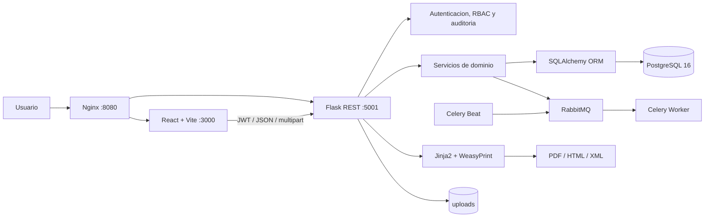
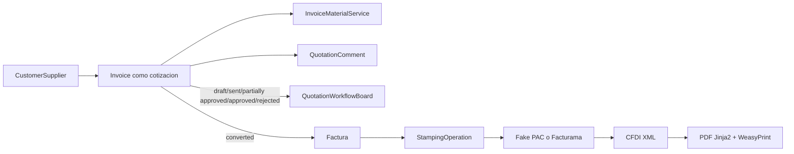
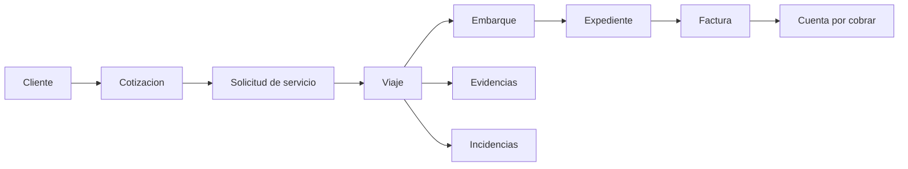
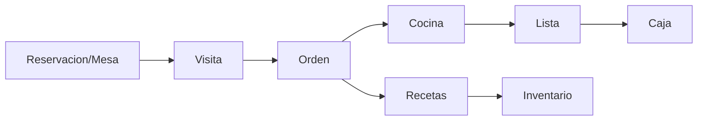

# Arquitectura actual de TYAKXA TNY

> Estado documentado: 22 de agosto de 2026  
> Alcance: `tyakxa_tny/`  
> Fuente de verdad: declaraciones presentes en el codigo; se excluyen `node_modules`, caches, artefactos compilados y respaldos.

## 1. Resumen ejecutivo

TYAKXA TNY es un ERP modular y multi-proyecto. La interfaz es una SPA React; la API principal es Flask con SQLAlchemy; PostgreSQL almacena la informacion transaccional; RabbitMQ, Celery Worker y Celery Beat ejecutan trabajo asincrono; Jinja2 y WeasyPrint generan documentos; Nginx publica el sistema en `http://localhost:8080`.

Inventario verificable actual:

| Superficie | Cantidad | Fuente |
|---|---:|---|
| Entidades ORM con `__tablename__` | 119 | `tyakxa_tny/backend/app/models/` |
| Registros de blueprint | 86 | `tyakxa_tny/backend/app/__init__.py` |
| Reglas REST declaradas en `routes/` | 325 | `tyakxa_tny/backend/app/routes/` |
| Rutas React declaradas | 99 | `tyakxa_tny/frontend/src/App.jsx` |
| Archivos JSX | 103 | `tyakxa_tny/frontend/src/` |
| Paginas JSX | 89 | `tyakxa_tny/frontend/src/pages/` |
| Componentes reutilizables | 6 | `tyakxa_tny/frontend/src/components/` |
| Servicios Docker Compose | 7 | `tyakxa_tny/docker-compose.yml` |

## 2. Vista por capas



Responsabilidades:

| Capa | Ubicacion | Responsabilidad |
|---|---|---|
| Presentacion | `frontend/src/` | Rutas, layouts, formularios, tableros y consumo REST. |
| API REST | `backend/app/routes/` | Blueprints, autenticacion, permisos, validacion de entrada y respuestas HTTP. |
| Servicios | `backend/app/services/` | Casos de uso, CRUD, cotizaciones, facturacion, timbrado, banca y logistica. |
| Dominio/persistencia | `backend/app/models/` | 119 entidades SQLAlchemy y sesiones transaccionales. |
| GraphQL | `backend/app/graphql/` | Schema, queries, mutations, tipos, filtros e inputs; actualmente no se registra en `create_app`. |
| Documentos | `documents-reports/` | Manifiesto, Jinja2, HTML, XML y PDF con WeasyPrint. |
| Procesamiento asincrono | `backend/app/tasks/`, `celery_worker.py` | KPI, documentos pendientes y sincronizacion SCM. |
| Datos | `database/` | Inicializacion, semillas y migraciones SQL. |
| Operacion | `infra/`, `maintenance/` | Contenedores, Nginx, respaldos, restauracion y salud. |

## 3. Backend

### 3.1 Fabrica de aplicacion

`backend/app/__init__.py` implementa `create_app(testing=False)`. Configura Flask, CORS, Babel, `UPLOAD_ROOT`, blueprints, errores estructurados y la ruta publica de imagenes de producto. El acceso a datos usa `transaction_context()` en `backend/app/models/session.py`; confirma la transaccion al terminar y cierra la sesion.

Patron principal de entidades:

```text
HTTP -> Blueprint -> token_required -> require_entity_permission
     -> Service/CrudService -> transaction_context -> SQLAlchemy -> PostgreSQL
```

Los CRUD convencionales exponen:

```text
GET    /<entidad>/             lista paginada, filtrada y ordenada
GET    /<entidad>/<id>         detalle
POST   /<entidad>/             alta
PUT    /<entidad>/<id>         modificacion
DELETE /<entidad>/<id>         baja segun el servicio
```

### 3.2 Catalogo completo de entidades ORM

Cada fila corresponde a una clase con tabla real. `Base` y el manejador de sesiones no son entidades.

#### Identidad, organizacion y seguridad

| Entidad | Tabla | Modulo | Relaciones principales |
|---|---|---|---|
| `User` | `user` | `user.py` | `permission`, `proyect`, `status` |
| `UserMfa` | `user_mfa` | `user_mfa.py` | `user` |
| `PasswordResetToken` | `password_reset_token` | `password_reset_token.py` | `user` |
| `Permission` | `permission` | `permission.py` | autorizador `user`, `department`, `subdepartment`, `level` |
| `EntityPermission` | `entity_permission` | `entity_permission.py` | permisos CRUD por rol/entidad |
| `Field` | `field` | `field.py` | catalogo de campos protegibles |
| `NmFieldPermission` | `nm_field_permission` | `nm_field_permission.py` | `field`, `permission` |
| `PublicApiKey` | `public_api_key` | `public_api_key.py` | credencial de API publica |
| `AuditLog` | `audit_log` | `audit_log.py` | auditoria de seguridad |
| `EventLog` | `event_log` | `event_log.py` | eventos funcionales/tecnicos |
| `Department` | `department` | `department.py` | padre de `subdepartment` |
| `Subdepartment` | `subdepartment` | `subdepartment.py` | `department` |
| `Level` | `level` | `level.py` | nivel organizacional |
| `Status` | `status` | `status.py` | estado compartido |
| `Theme` | `theme` | `theme.py` | configuracion visual |

#### CRM, ventas, catalogos e inventario

| Entidad | Tabla | Modulo | Relaciones principales |
|---|---|---|---|
| `CustomerSupplier` | `customer_supplier` | `customer_supplier.py` | propietario `user`; cliente, proveedor y emisor fiscal |
| `Proyect` | `proyect` | `proyect.py` | `customer_supplier`, lider `user` |
| `Brand` | `brand` | `brand.py` | marca de materiales/servicios |
| `Unit` | `unit` | `unit.py` | unidad de medida |
| `Material` | `material` | `material.py` | `unit`, `brand`, `product_family` |
| `MaterialComponent` | `material_component` | `material_component.py` | material padre, material componente, `unit` |
| `Service` | `service` | `service.py` | `brand` |
| `ProductFamily` | `product_family` | `product_family.py` | familia comercial |
| `Product` | `product` | `product.py` | `invoice`, `location`, `material` |
| `ProductSaleConfig` | `product_sale_config` | `product_sale_config.py` | `product`, `inventory_status` |
| `LocationType` | `location_type` | `location_type.py` | tipo de ubicacion |
| `Location` | `location` | `location.py` | `location_type` |
| `InventoryStatus` | `inventory_status` | `inventory_status.py` | `department`, `subdepartment`, `level` |
| `InventoryLedger` | `inventory_ledger` | `inventory_ledger.py` | `product`, `proyect` |
| `Movement` | `movement` | `movement.py` | `fiscal_account` |

#### Cotizacion, facturacion, banca y fiscal

| Entidad | Tabla | Modulo | Relaciones principales |
|---|---|---|---|
| `Invoice` | `invoice` | `invoice.py` | receptor y emisor `customer_supplier`, `status`, `proyect` |
| `InvoiceMaterialService` | `invoice_material_service` | `invoice_material_service.py` | `invoice`, material/servicio/producto, unidad, usuarios, cliente, estado y tarea |
| `QuotationComment` | `quotation_comment` | `quotation_comment.py` | `invoice`, `user` |
| `Bank` | `bank` | `bank.py` | catalogo bancario |
| `BankAccount` | `bank_account` | `bank_account.py` | `bank`, `proyect` |
| `BankStatement` | `bank_statement` | `bank_statement.py` | `bank_account`, `proyect` |
| `BankStatementMovement` | `bank_statement_movement` | `bank_statement.py` | `bank_statement`, conciliacion con `invoice` |
| `FiscalAccount` | `fiscal_account` | `fiscal_account.py` | cuenta fiscal/contable |
| `FiscalStamp` | `fiscal_stamp` | `fiscal_stamp.py` | sello fiscal |
| `FiscalRecord` | `fiscal_record` | `fiscal_record.py` | `fiscal_account`, `fiscal_stamp` |
| `PacConfig` | `pac_config` | `pac_config.py` | configuracion cifrada del PAC |
| `StampingOperation` | `stamping_operation` | `stamping_operation.py` | `invoice`, `proyect`, idempotencia y estado PAC |

#### Trabajo, incidencias, encuestas y nomina

| Entidad | Tabla | Modulo | Relaciones principales |
|---|---|---|---|
| `Task` | `task` | `task.py` | propietario `user`, `proyect` |
| `TaskNote` | `task_note` | `task_note.py` | `task` |
| `TaskType` | `task_type` | `task_type.py` | tipo de tarea |
| `Template` | `template` | `template.py` | plantilla de trabajo |
| `NmTemplateTask` | `nm_template_task` | `nm_template_task.py` | `task`, `template` |
| `Ticket` | `ticket` | `ticket.py` | ticket operativo |
| `IncidentType` | `incident_type` | `incident_type.py` | tipo de incidencia |
| `Incident` | `incident` | `incident.py` | `incident_type`, `user` |
| `IncidentDetail` | `incident_detail` | `incident_detail.py` | `incident_type` |
| `NmIncidentProduct` | `nm_incident_product` | `nm_incident_product.py` | `incident`, `product` |
| `SurveyQuestion` | `survey_question` | `survey_question.py` | propietario `user` |
| `SurveyMultipleAnswer` | `survey_multiple_answer` | `survey_multiple_answer.py` | `survey_question` |
| `NmSurveyUser` | `nm_survey_user` | `nm_survey_user.py` | pregunta, respuesta, `user`, `status` |
| `PayrollPeriod` | `payroll_period` | `payroll_period.py` | `status` |
| `PayrollConcept` | `payroll_concept` | `payroll_concept.py` | concepto de percepcion/deduccion |
| `PayrollDetail` | `payroll_detail` | `payroll_detail.py` | `payroll_period`, `user` |
| `PayrollMovement` | `payroll_movement` | `payroll_movement.py` | `payroll_detail`, `payroll_concept` |

#### Logistica

| Entidad | Tabla | Relaciones principales |
|---|---|---|
| `LogisticsAddress` | `logistics_address` | `customer_supplier` |
| `LogisticsContact` | `logistics_contact` | `customer_supplier` |
| `LogisticsContract` | `logistics_contract` | `customer_supplier` |
| `LogisticsRate` | `logistics_rate` | `customer_supplier` |
| `LogisticsQuotation` | `logistics_quotation` | `customer_supplier`, creador `user` |
| `LogisticsServiceRequest` | `logistics_service_request` | cliente, `logistics_quotation`, creador |
| `LogisticsTrip` | `logistics_trip` | solicitud, cliente, unidad, remolque, operador, expediente, creador |
| `LogisticsShipment` | `logistics_shipment` | cliente, creador |
| `LogisticsEvidence` | `logistics_evidence` | viaje, capturista y creador |
| `LogisticsIncident` | `logistics_incident` | viaje, responsable y creador |
| `LogisticsBranch` | `logistics_branch` | creador `user` |
| `LogisticsReceivable` | `logistics_receivable` | `invoice`, cliente, creador |
| `LogisticsFile` | `logistics_file` | cliente, sucursal, `invoice`, creador |
| `LogisticsOperator` | `logistics_operator` | operador de flota |
| `LogisticsUnit` | `logistics_unit` | unidad tractora |
| `LogisticsTrailer` | `logistics_trailer` | remolque |
| `LogisticsMaintenance` | `logistics_maintenance` | `logistics_unit` |
| `LogisticsWarehouse` | `logistics_warehouse` | almacen |
| `LogisticsLocation` | `logistics_location` | `logistics_warehouse` |
| `LogisticsRack` | `logistics_rack` | cliente, `logistics_location` |
| `LogisticsInventory` | `logistics_inventory` | cliente, `logistics_location` |

Los modulos de estas entidades son homonimos: `backend/app/models/logistics_<nombre>.py`.

#### Restaurante

Las once entidades viven en `backend/app/models/restaurant.py` y comparten metadatos de auditoria mediante `RestaurantRecord`.

| Entidad | Tabla | Relaciones principales |
|---|---|---|
| `RestaurantWaiter` | `restaurant_waiter` | `proyect`, `user` |
| `RestaurantTable` | `restaurant_table` | `proyect` |
| `RestaurantGuisado` | `restaurant_guisado` | `proyect` |
| `RestaurantDish` | `restaurant_dish` | `proyect` |
| `RestaurantVisit` | `restaurant_visit` | `proyect`, mesa, mesero |
| `RestaurantOrder` | `restaurant_order` | `proyect`, visita, mesero |
| `RestaurantOrderItem` | `restaurant_order_item` | orden, platillo, guisados |
| `RestaurantReservation` | `restaurant_reservation` | `proyect`, mesa |
| `RestaurantInventoryItem` | `restaurant_inventory_item` | `proyect` |
| `RestaurantRecipeItem` | `restaurant_recipe_item` | `proyect`, platillo, insumo de inventario |
| `RestaurantCashSession` | `restaurant_cash_session` | `proyect`, usuarios de apertura/cierre |

#### KPIs

Las cuatro entidades viven en archivos homonimos (`kpi_definition.py`,
`nm_permission_kpi.py`, `kpi_dashboard.py`, `kpi_dashboard_widget.py`).
Modulo de registro: `kpis` (`backend/app/modules/registry.py`). A diferencia
del resto de los modulos de negocio, no tiene apartado propio en el menu
lateral: sus pantallas se sirven desde el Home/Dashboard actual (ruta "/"),
que ya es de acceso libre para cualquier usuario autenticado, asi que sus
filas de `entity_permission` se siembran con `menu_location = 'hidden'`.

| Entidad | Tabla | Relaciones principales |
|---|---|---|
| `KpiDefinition` | `kpi_definition` | catalogo de indicadores disponibles |
| `NmPermissionKpi` | `nm_permission_kpi` | `permission`, `kpi_definition` |
| `KpiDashboard` | `kpi_dashboard` | tablero personalizable, por `user` |
| `KpiDashboardWidget` | `kpi_dashboard_widget` | `kpi_dashboard`, `kpi_definition` |

### 3.3 Catalogo completo de blueprints

`create_app` contiene 86 llamadas de registro: 85 blueprints estaticos y Documents, que se registra dinamicamente si existe `DOCUMENTS_REPORTS_APP_PATH`. La mayoria de los blueprints de entidad usa JWT, permiso por entidad y CRUD estandar.

#### Plataforma, seguridad y canales publicos

| Blueprint | Prefijo/ruta base | Modulo | Comportamiento |
|---|---|---|---|
| `bp_health` | `/health` | `health.py` | Salud publica. |
| `bp_auth` | `/auth` | `auth.py` | Login y ciclo MFA. |
| `bp_security` | `/security` | `security.py` | Catalogo y comprobacion RBAC. |
| `bp_user` | `/user` | `user.py` | CRUD usuarios. |
| `bp_user_mfa` | `/user_mfa` | `user_mfa.py` | CRUD tecnico MFA. |
| `bp_permission` | `/permission` | `permission.py` | Roles/permisos. |
| `bp_entity_permission` | `/entity_permission` | `entity_permission.py` | Matriz rol-entidad. |
| `bp_nm_field_permission` | `/nm_field_permission` | `nm_field_permission.py` | Permisos por campo. |
| `bp_field` | `/field` | `field.py` | Catalogo de campos. |
| `bp_event_log` | `/event_log` | `event_log.py` | Auditoria/eventos. |
| `bp_public_api_key` | `/public_api_key` | `public_api_key.py` | Gestion de claves publicas. |
| `bp_public_auth` | `/public/auth` | `public_auth.py` | Registro, login, recuperacion y perfil publico. |
| `bp_public_catalog` | `/public` | `public_catalog.py` | Productos/servicios publicos. |
| `bp_web_shoppers` | `/web-shoppers` | `web_shoppers.py` | Compradores web. |
| `bp_sales_catalog` | `/sales-catalog` | `sales_catalog.py` | Catalogo comercial y precio. |
| `bp_sales_catalog_api_keys` | `/sales-catalog/api-keys` | `sales_catalog_api_keys.py` | Claves del catalogo. |
| `bp_client_portal` | `/public/client-portal` | `client_portal.py` | Consulta y decision de cotizaciones. |

Nota: `backend/app/routes/routes_security.py` tambien declara `bp_security`, pero no se importa ni registra. `backend/app/graphql/routes.py` declara `bp_graphql` en `/graphql`, pero `create_app` tampoco lo registra; GraphQL esta implementado, no activo.

#### Maestros, operaciones y administracion

| Blueprint | Prefijo | Blueprint | Prefijo |
|---|---|---|---|
| `bp_department` | `/department` | `bp_subdepartment` | `/subdepartment` |
| `bp_level` | `/level` | `bp_status` | `/status` |
| `bp_theme` | `/theme` | `bp_proyect` | `/proyect` |
| `bp_customer_supplier` | `/customer_supplier` | `bp_brand` | `/brand` |
| `bp_unit` | `/unit` | `bp_location_type` | `/location_type` |
| `bp_location` | `/location` | `bp_material` | `/material` |
| `bp_material_component` | `/material_component` | `bp_service` | `/service` |
| `bp_product_family` | `/product_family` | `bp_product` | `/product` |
| `bp_product_sale_config` | `/product_sale_config` | `bp_inventory_status` | `/inventory_status` |
| `bp_movement` | `/movement` | `bp_task` | `/task` |
| `bp_task_note` | `/task_note` | `bp_task_type` | `/task_type` |
| `bp_template` | `/template` | `bp_nm_template_task` | `/nm_template_task` |
| `bp_ticket` | `/ticket` | `bp_incident_type` | `/incident_type` |
| `bp_incident` | `/incident` | `bp_incident_detail` | `/incident_detail` |
| `bp_nm_incident_product` | `/nm_incident_product` | `bp_survey_question` | `/survey_question` |
| `bp_survey_multiple_answer` | `/survey_multiple_answer` | `bp_nm_survey_user` | `/nm_survey_user` |

Cada nombre corresponde al archivo homonimo en `backend/app/routes/`.

#### Facturacion, fiscal, banca, nomina e integraciones

| Blueprint | Prefijo | Modulo/alcance |
|---|---|---|
| `bp_invoice` | `/invoice` | CRUD, lineas, carga, XML, PDF, cotizacion, factura manual y ciclo de estado. |
| `bp_invoice_material_service` | `/invoice_material_service` | Partidas de factura/cotizacion. |
| `bp_fiscal_account` | `/fiscal_account` | CRUD de cuentas fiscales. |
| `bp_fiscal_stamp` | `/fiscal_stamp` | CRUD de sellos. |
| `bp_fiscal_record` | `/fiscal_record` | CRUD de registros fiscales. |
| `bp_stamping` | `/stamping` | Configuracion PAC, prueba y timbrado. |
| `bp_bank` | `/bank` | CRUD de bancos. |
| `bp_bank_account` | `/bank_account` | CRUD de cuentas. |
| `bp_bank_statements` | `/bank-statements` | Vista previa, importacion y conciliacion. |
| `bp_payroll_period` | `/payroll_period` | Periodos de nomina. |
| `bp_payroll_concept` | `/payroll_concept` | Conceptos. |
| `bp_payroll_detail` | `/payroll_detail` | Detalles por usuario. |
| `bp_payroll_movement` | `/payroll_movement` | Movimientos. |
| `bp_kronos` | `/kronos` | Dispositivos/asistencia Kronos. |
| `bp_restaurant` | `/restaurant` | Mesero, cocina, caja y administracion. |
| `bp_documents` | `/documents` | Manifiesto y render HTML/PDF/XML; registro condicional. |

`bp_documents` se crea en `documents-reports/app/documents/routes.py`. Sus rutas son `GET /documents/manifest` y `GET /documents/<document_key>/<record_id>?format=html|pdf|xml`.

#### Logistica

| Blueprint | Prefijo | Blueprint | Prefijo |
|---|---|---|---|
| `bp_logistics_address` | `/logistics_address` | `bp_logistics_contact` | `/logistics_contact` |
| `bp_logistics_contract` | `/logistics_contract` | `bp_logistics_rate` | `/logistics_rate` |
| `bp_logistics_operator` | `/logistics_operator` | `bp_logistics_unit` | `/logistics_unit` |
| `bp_logistics_trailer` | `/logistics_trailer` | `bp_logistics_maintenance` | `/logistics_maintenance` |
| `bp_logistics_warehouse` | `/logistics_warehouse` | `bp_logistics_location` | `/logistics_location` |
| `bp_logistics_rack` | `/logistics_rack` | `bp_logistics_inventory` | `/logistics_inventory` |
| `bp_logistics_quotation` | `/logistics_quotation` | `bp_logistics_service_request` | `/logistics_service_request` |
| `bp_logistics_trip` | `/logistics_trip` | `bp_logistics_shipment` | `/logistics_shipment` |
| `bp_logistics_evidence` | `/logistics_evidence` | `bp_logistics_incident` | `/logistics_incident` |
| `bp_logistics_branch` | `/logistics_branch` | `bp_logistics_receivable` | `/logistics_receivable` |
| `bp_logistics_file` | `/logistics_file` |  |  |

Los nueve blueprints de workflow (`quotation`, `service_request`, `trip`, `evidence`, `incident`, `shipment`, `branch`, `receivable`, `file`) se generan con `create_crud_blueprint` en `logistics_workflow.py`; los demas tienen modulo propio.

### 3.4 Endpoints especializados

Ademas del CRUD estandar, las superficies principales son:

| Dominio | Endpoints relevantes |
|---|---|
| Auth | `POST /auth/login`, `/auth/mfa/verify-login`, `/auth/mfa/setup`, `/auth/mfa/enable`. |
| Facturacion | `GET /invoice/<id>/lines`, `/xml`, `/pdf`; `POST /invoice/manual/preview`, `/manual`; catalogos, carga y transiciones. |
| Cotizacion publica | `GET /public/client-portal/quotations`, detalle y `POST .../decision`. |
| PAC | `GET/PUT /stamping/config`, `POST /stamping/config/test` y operacion de timbrado. |
| Banca | `POST /bank-statements/preview`, `/import/preview`, `/import`; consulta y conciliacion. |
| Catalogo | Productos publicos; previsualizacion de precio y configuracion comercial. |
| Restaurante | Bootstrap y acciones especializadas por mesero, cocina, caja y administracion. |
| Documentos | Manifiesto y render por llave de documento. |

### 3.5 Seguridad

- `token_required` valida JWT HS256.
- `require_entity_permission(entity, action)` aplica RBAC a nivel de entidad.
- `control_type` es una mascara: crear `1`, leer `2`, actualizar `4`, eliminar `8`.
- `NmFieldPermission` complementa el control a nivel de campo.
- Usuarios bootstrap/superusuario tienen tratamiento explicito en backend y frontend.
- MFA usa TOTP y secretos cifrados.
- Configuracion PAC se cifra antes de persistirse.
- Portal, catalogo y compradores usan scopes/credenciales publicas separados del JWT interno.
- `AuditLog` y `EventLog` conservan trazabilidad de seguridad y operacion.
- El acceso a documentos de factura verifica JWT, permiso `invoice:read` y pertenencia al proyecto.

## 4. Frontend

### 4.1 Arranque, estado y acceso

- `frontend/src/main.jsx`: monta React e inicializa i18n.
- `frontend/src/App.jsx`: contiene el router, `TechnicalRoute`, `AdminRoute` y `RoleAccessRoute`.
- `frontend/src/api/client.js`: cliente HTTP central con JWT y manejo comun de errores.
- `frontend/src/api/index.js`: funciones REST por entidad.
- `frontend/src/api/restaurant.js`: cliente especializado del restaurante.
- No hay Redux ni otro store global: autenticacion/usuario se conserva en `localStorage`; el estado de vista es React local.
- `i18n/frontend/`: fuente canonica de diccionarios del frontend (`de`, `en`, `es`, `pt`), validados por `i18n/i18n_report.json`.
- `frontend/src/i18n/locales/`: copia sincronizada que consume React; no debe editarse como una fuente independiente.
- `frontend/src/i18n/index.js`: inicializacion, seleccion de idioma y fallback a espanol.

### 4.2 Componentes de aplicacion y layouts

| Componente | Archivo | Responsabilidad |
|---|---|---|
| `App` | `App.jsx` | Router y guardas de rol. |
| `ProtectedRoute` | `auth/ProtectedRoute.jsx` | Exige sesion. |
| `LoginPage` | `auth/LoginPage.jsx` | Login y MFA. |
| `Shell` | `layouts/Shell.jsx` | Estructura principal y navegacion modular. |
| `AppLayout` | `layouts/AppLayout.jsx` | Layout alterno/base. |
| `Header` | `layouts/Header.jsx` | Encabezado. |
| `Sidebar` | `layouts/Sidebar.jsx` | Navegacion lateral. |
| `BankStatementsPanel` | `components/BankStatementsPanel.jsx` | Importacion y conciliacion bancaria. |
| `InvoiceCreationForm` | `components/InvoiceCreationForm.jsx` | Captura fiscal completa. |
| `InvoiceUploadWidget` | `components/InvoiceUploadWidget.jsx` | Carga y validacion CFDI. |
| `Kanban` | `components/Kanban.jsx` | Tablero de tareas. |
| `KronosDeviceConnection` | `components/KronosDeviceConnection.jsx` | Conexion de dispositivo Kronos. |
| `QuotationWorkflowBoard` | `components/QuotationWorkflowBoard.jsx` | Tablero de seis estados de cotizacion. |

### 4.3 Catalogo completo de paginas

#### ERP, CRM, ventas y administracion

```text
Dashboard
AuthorizationTrackingPage
BankPage
BankAccountPage
BrandPage
CatalogoWebPage
ClientPortalPage
CustomerSupplierPage
DepartmentPage
EntityPermissionPage
EventLogPage
FieldPage
FiscalAccountPage
FiscalRecordPage
FiscalStampPage
IncidentPage
IncidentDetailPage
IncidentTypePage
InventoryStatusPage
InvoicePage
InvoiceMaterialServicePage
LevelPage
LocationPage
LocationTypePage
ManualInvoicePage
MaterialPage
MaterialComponentPage
MfaSetupPage
MovementPage
NmFieldPermissionPage
NmIncidentProductPage
NmSurveyUserPage
NmTemplateTaskPage
PayrollConceptPage
PayrollDetailPage
PayrollMovementPage
PayrollPeriodPage
PermissionPage
ProductPage
ProductFamilyPage
ProductSaleConfigPage
ProyectPage
PublicApiKeyPage
QuotationPage
RolePermissionManagerPage
ServicePage
StatusPage
SubdepartmentPage
SurveyMultipleAnswerPage
SurveyQuestionPage
TaskPage
TaskNotePage
TaskTypePage
TemplatePage
ThemePage
TicketPage
UnitPage
UserPage
UserMfaPage
WebShoppersPage
KronosPage
KronosDevicePage
```

Todas estan en `frontend/src/pages/<nombre>.jsx`.

#### Logistica

```text
LogisticsAddressesPage
LogisticsBranchesPage
LogisticsContactsPage
LogisticsContractsPage
LogisticsEntityPage
LogisticsEvidencesPage
LogisticsFilesPage
LogisticsIncidentsPage
LogisticsInventoryPage
LogisticsLocationsPage
LogisticsMaintenancePage
LogisticsOperatorsPage
LogisticsQuotationsPage
LogisticsRacksPage
LogisticsRatesPage
LogisticsReceivablesPage
LogisticsServiceRequestsPage
LogisticsShipmentsPage
LogisticsTrailersPage
LogisticsTripsPage
LogisticsUnitsPage
LogisticsWarehousesPage
```

Viven en `frontend/src/pages/logistics/`. `LogisticsEntityPage` es la pagina CRUD generica que comparten las especializaciones.

#### Restaurante

```text
RestaurantAdminPage
RestaurantCashierPage
RestaurantKitchenPage
RestaurantUi
RestaurantWaiterPage
```

Viven en `frontend/src/pages/restaurant/`. `RestaurantUi` contiene piezas visuales compartidas y no es una ruta independiente.

### 4.4 Mapa de rutas React

Rutas publicas:

| Ruta | Componente |
|---|---|
| `/login` | `LoginPage` |
| `/portal-cliente` | `ClientPortalPage` |

Rutas protegidas de negocio:

```text
/                         Dashboard
/quotation                QuotationPage
/authorization_tracking   AuthorizationTrackingPage
/invoice                  InvoicePage
/invoice/manual           ManualInvoicePage
/invoice_material_service InvoiceMaterialServicePage
/customer_supplier        CustomerSupplierPage
/catalogo-web             CatalogoWebPage
/compradores-web          WebShoppersPage
/bank                     BankPage
/bank_account             BankAccountPage
/kanban                   Kanban
/kronos                   KronosPage
/kronos/device            KronosDevicePage
```

Cada pagina maestra usa como ruta su nombre de entidad en `snake_case`: `/brand`, `/department`, `/field`, `/fiscal_account`, `/fiscal_record`, `/fiscal_stamp`, `/incident`, `/incident_detail`, `/incident_type`, `/inventory_status`, `/level`, `/location`, `/location_type`, `/material`, `/material_component`, `/movement`, `/nm_incident_product`, `/nm_survey_user`, `/nm_template_task`, `/payroll_concept`, `/payroll_detail`, `/payroll_movement`, `/payroll_period`, `/permission`, `/product`, `/product_family`, `/product_sale_config`, `/proyect`, `/public_api_key`, `/service`, `/status`, `/subdepartment`, `/survey_multiple_answer`, `/survey_question`, `/task`, `/task_note`, `/task_type`, `/template`, `/theme`, `/ticket`, `/unit`, `/user`.

Administracion/tecnicas:

```text
/mfa-setup
/role_permissions
/entity_permission
/nm_field_permission
/event_log
/user_mfa
```

Logistica:

```text
/logistica/clientes          /logistica/proveedores
/logistica/contactos         /logistica/direcciones
/logistica/contratos         /logistica/tarifas
/logistica/cotizaciones      /logistica/solicitudes
/logistica/viajes            /logistica/evidencias
/logistica/incidencias       /logistica/unidades
/logistica/remolques         /logistica/operadores
/logistica/mantenimientos    /logistica/almacenes
/logistica/ubicaciones       /logistica/inventario
/logistica/racks             /logistica/embarques
/logistica/sucursales        /logistica/cuentas-cobrar
/logistica/expedientes       /logistica/facturas
/logistica/facturacion/manual
/logistica/usuarios          /logistica/roles
/logistica/auditoria         /logistica/seguridad
```

Restaurante: `/restaurant/waiter`, `/restaurant/cashier`, `/restaurant/kitchen`, `/restaurant/admin`.

## 5. Flujos de negocio

### 5.1 CRM, cotizacion y factura



- CRM usa `CustomerSupplier` como maestro de clientes/proveedores y lo extiende con contactos, direcciones, contratos y tarifas logisticas.
- Cotizacion reutiliza `Invoice` y sus partidas; el frontend ofrece Tablero y Gestionar.
- El portal publico permite consultar y aceptar/rechazar una cotizacion mediante token de alcance publico.
- La factura manual valida receptor, emisor, conceptos SAT, impuestos, retenciones, forma y metodo de pago.
- Timbrado es idempotente mediante `StampingOperation`; el PAC activo puede ser falso o Facturama.
- XML original se almacena en `uploads/cfdi_xml`; el PDF se produce bajo demanda.

### 5.2 Logistica



Maestros de flota: operadores, unidades, remolques y mantenimientos. WMS: almacenes, ubicaciones, racks e inventario. CRM logistico: clientes/proveedores, contactos, direcciones, contratos y tarifas.

### 5.3 Restaurante



Las vistas separan mesero, cocina, caja y administracion. Todas las entidades operativas se segmentan por `proyect` y conservan creador/estado temporal.

### 5.4 Banca

El flujo es `archivo -> preview -> importacion idempotente -> BankStatement/Movement -> asociacion con Invoice -> conciliacion`. `BankStatementsPanel` concentra la experiencia frontend.

## 6. Documentos y archivos

| Recurso | Implementacion |
|---|---|
| Manifiesto | `documents-reports/app/documents/manifest.py` |
| Render | `documents-reports/app/documents/service.py` |
| Rutas | `documents-reports/app/documents/routes.py` |
| Plantillas | `documents-reports/templates/` |
| Factura PDF | `invoice_pdf.html` |
| Cotizacion PDF | `quotation_pdf.html` |
| XML CFDI | XML original validado, no reconstruido para descarga |
| Motor | Jinja2 + WeasyPrint |

El backend tambien expone rutas autenticadas estables en `/invoice/<id>/xml` y `/invoice/<id>/pdf`; `?document=quotation` selecciona la cotizacion.

## 7. Infraestructura de ejecucion

| Servicio Compose | Puerto | Funcion |
|---|---|---|
| `db` | host `5433` por defecto | PostgreSQL 16 y volumen `db_data`. |
| `rabbitmq` | `5672`, administracion `15672` | Broker Celery. |
| `backend` | `5001` | Flask API y montaje de backend/uploads/documentos/database. |
| `celery-worker` | interno | Ejecucion de tareas. |
| `celery-beat` | interno | Programacion de tareas. |
| `frontend` | `3000` | Vite en modo desarrollo. |
| `nginx` | `8080` | Punto de entrada y proxy. |

Persistencia y operacion:

- `database/init.sql` y `database/seed.sql` inicializan una base nueva.
- `database/migrations/` contiene la evolucion incremental.
- `uploads/` conserva XML, estados bancarios, sellos y archivos de negocio.
- `infra/backups/` recibe respaldos.
- `maintenance/` contiene backup, restore, rotacion, vacuum/analyze y healthcheck.
- Localizacion backend/frontend: espanol, ingles, aleman y portugues; frontend agrega japones.

### 7.1 Despliegue en Kubernetes (clúster k3s)

> Agregado 2026-09-01. Docker Compose (arriba) es el ambiente de desarrollo
> local; en el clúster real (`tyakxa-dev`, `torredigital-prod`, `adser-prod`,
> 168.231.67.33) el runtime es Kubernetes, con manifiestos en `k8s/base/` y
> overlays por cliente en `k8s/overlays/<cliente>-<env>/`. El clúster **solo
> hace pull**: las imágenes las construye GitHub Actions y se etiquetan con
> el SHA corto del commit; nunca hay código fuente en el servidor, solo
> configuración y la referencia a la imagen.

**Migraciones: un solo mecanismo autoritativo, no dos.** El esquema de
Postgres lo gobierna exclusivamente el initContainer `db-migrate`
(`k8s/base/backend.yaml`): un bucle `for f in /migrations/*.sql; do psql -v
ON_ERROR_STOP=1 -f "$f"; done` que corre **completo, en cada arranque del
pod**, sin tabla de tracking. Por diseño, toda migración bajo
`database/migrations/` debe ser segura de repetir (`CREATE TABLE IF NOT
EXISTS`, `ON CONFLICT ... DO NOTHING/UPDATE`, `DO $$ ... EXCEPTION WHEN
duplicate_object THEN NULL; END $$`) — **nunca** `NOT EXISTS (... WHERE
deletion_date IS NULL)` como única guarda: si una migración posterior da de
baja logica y resiembra la misma tabla (patron usado en
`entity_permission`, ver `20260828240000_module_permission_matrix.sql`), esa
guarda dejará una fila fantasma que choca contra el `UNIQUE` en el siguiente
reinicio del pod. Antes de escribir una migración con `INSERT`, verificar
contra un Postgres real corriendo la cadena completa dos veces seguidas
(`psql -v ON_ERROR_STOP=1`, mismo patrón que ya usaba el proyecto en
`docs/INTEGRACION_FUNCIONAL.md`), no solo una vez.

`backend/scripts/apply_migrations.py` (con su propia tabla `schema_migration`
y tracking por checksum) es una **herramienta de desarrollo aparte**, para
correr a mano contra una base local con `DATABASE_URL` propio. **No está
conectada a ningún arranque automático** — ni Docker Compose ni el
initContainer de k8s la usan — porque `DATABASE_URL` nunca se definió ni en
`app-secrets` (el Secret de k8s trae `DB_HOST`/`DB_NAME`/`DB_USER`/
`DB_PASSWORD`/`DB_PORT` por separado) ni en `docker-compose.yml`. Hasta
2026-09-01, `backend/entrypoint.sh` la invocaba igual al arrancar el
contenedor `backend`; nunca funcionó ahí (fallaba con "DATABASE_URL no esta
definida") y nunca se detectó porque el pod moría antes, en el
initContainer. Se quitó esa línea: `entrypoint.sh` solo corre `init_db.py`
(bootstrap idempotente de tablas/seed/admin) y levanta Flask/Gunicorn.
**Regla para quien edite `entrypoint.sh` o agregue un mecanismo de
migración nuevo: el initContainer de k8s es la única fuente de verdad del
esquema en el clúster.** Si se necesita `apply_migrations.py` en algún
ambiente real, hay que decidirlo explícitamente (agregar `DATABASE_URL` al
Secret, correr `--baseline` una vez) — no asumir que ya funciona.

**Nombres fijos:** Secret `app-secrets`, pull secret `ghcr-pull-secret`
(token clásico con `read:packages`, el registro es `ghcr.io/tyakxa` en
minúsculas). `kubectl set image` cambia el clúster pero no el archivo — el
siguiente `apply -f` revierte la versión; cambiar siempre la etiqueta en el
manifiesto y commitear.

**Los manifiestos de k8s en el VPS no se actualizan solos — hay que copiarlos
a mano.** Confirmado 2026-09-01: `/home/alanp/tyakxa_tny/k8s/` en el VPS **no
es un repositorio git** (solo una copia plana). El pipeline de CI (`.github/
workflows/build-images.yml`, job `deploy-tyakxa-dev`) SÍ mantiene esa copia al
día para una sola cosa — el tag de imagen en
`k8s/overlays/tyakxa-dev/kustomization.yaml`, vía `yq` calculado en cada
corrida — pero **cualquier otro cambio a un archivo bajo `k8s/`** (el
initContainer de `k8s/base/backend.yaml`, un overlay, un Secret nuevo) se
queda invisible en el clúster hasta que alguien lo copie a mano. El código de
la app y las migraciones SQL no tienen este problema — llegan bien en cada
push porque la imagen Docker se construye fresca desde GitHub, no desde esta
copia.

Se evaluó resolverlo con un clon git disperso (`git sparse-checkout`, solo la
carpeta `k8s/`) más una deploy key de solo lectura — técnicamente evita traer
código fuente al servidor (cumple "el clúster solo hace pull"), pero **la
política de la organización Tyakxa tiene las deploy keys deshabilitadas**
("Disabled by Tyakxa", captura del 2026-09-01) — recomiendan GitHub Apps en su
lugar. Se decidió no perseguirlo por ahora: el costo de copiar a mano es bajo
y ya pasó dos veces en una sesión sin mayor consecuencia una vez detectado.

**Procedimiento manual, hasta que se resuelva de raíz:** después de pushear
un cambio a cualquier archivo bajo `k8s/` (no solo el tag), copiar el o los
archivos afectados al VPS y volver a aplicar:

```bash
# desde tu maquina local, con el repo actualizado
scp "C:\Users\TDW2\OneDrive\Desktop\tyakxa_tny\k8s\base\backend.yaml" `
  168.231.67.33:/home/alanp/tyakxa_tny/k8s/base/backend.yaml

# ya en el VPS
cd /home/alanp/tyakxa_tny
kubectl apply -k k8s/overlays/tyakxa-dev
```

Aplica igual para `torredigital-prod`/`adser-prod` (esos overlays tampoco
tienen CD automatizado — ver sección 10, punto 9).

## 8. Tareas asincronas

`backend/app/tasks/erp_tasks.py` declara:

| Tarea | Proposito |
|---|---|
| `erp.recalculate_kpis` | Recalculo extensible de indicadores. |
| `erp.generate_pending_documents` | Generacion de documentos pendientes. |
| `erp.sync_scm_stock` | Sincronizacion de existencias SCM. |

Celery Worker consume RabbitMQ y Celery Beat agenda ejecuciones periodicas.

## 9. Pruebas y validacion

```bash
# Stack
cd tyakxa_tny
docker compose up -d
docker compose ps

# Backend
docker compose exec -T backend python -m unittest

# Frontend
docker compose exec -T frontend npm run lint
docker compose exec -T frontend npm run build

# Configuracion Compose
docker compose config --quiet
```

Comandos para comprobar que este documento sigue completo:

```bash
cd tyakxa_tny
rg -l '__tablename__\s*=' backend/app/models --glob '*.py' \
  | xargs rg '__tablename__\s*=' | wc -l
rg 'app\.register_blueprint\(' backend/app/__init__.py | wc -l
rg '@bp_[A-Za-z0-9_]+\.route\(' backend/app/routes --glob '*.py' | wc -l
rg --files frontend/src --glob '*.jsx' | wc -l
rg --files frontend/src/pages --glob '*.jsx' | wc -l
rg '<Route ' frontend/src/App.jsx | wc -l
```

## 10. Decisiones y deuda arquitectonica visible

1. `Invoice` representa tanto cotizacion como factura; simplifica la conversion, pero exige distinguir claramente `invoice_status` y permisos en servicios/documentos.
2. REST es la API activa. GraphQL tiene implementacion completa, pero no esta montado por `create_app`.
3. Hay dos modulos que declaran `bp_security`; solo `backend/app/routes/security.py` esta activo.
4. Parte de la API sigue el CRUD generado por entidad y otra parte usa servicios de dominio especializados. Los nuevos flujos deben preferir el servicio propietario del comportamiento.
5. `App.jsx` concentra 99 rutas y `Shell.jsx` concentra la navegacion; ambos son puntos sensibles al agregar modulos.
6. La autorizacion se aplica en backend y se refleja en frontend, pero el backend es siempre la frontera de seguridad.
7. `mobile/` y `reports/` no forman parte activa del runtime actual.
8. `apply_migrations.py` existe en el repo pero no gobierna ningun ambiente real (ni Compose ni k8s); es solo herramienta de desarrollo. Ver 7.1. Confirmado 2026-09-01 al corregir el CrashLoopBackOff de `tyakxa-dev`.
9. `torredigital-prod` y `adser-prod` no tienen CD: los tags de imagen se fijan a mano en `k8s/overlays/<cliente>-prod/kustomization.yaml`. Al 2026-09-01 corren una version anterior a los ultimos 4 fixes de migracion/`entrypoint.sh`; pendiente decidir cuando promoverlos.

## 11. Regla de mantenimiento

Actualizar este documento cuando se agregue o elimine cualquiera de los siguientes elementos:

- una clase SQLAlchemy con `__tablename__`;
- un `register_blueprint` o una ruta especializada;
- una pagina, componente o ruta React;
- un servicio Compose, cola Celery o almacen persistente;
- una transicion importante en CRM, cotizacion, CFDI, logistica, banca o restaurante;
- una migracion SQL nueva que otorgue permisos (`entity_permission`) o cree tablas, o cualquier cambio a `backend/entrypoint.sh`, al initContainer `db-migrate` (`k8s/base/backend.yaml`) o a que ambiente (`tyakxa-dev`/`torredigital-prod`/`adser-prod`) tiene desplegado que fix — somos 3 trabajando en este repo y solo uno despliega; sin esto se pierde de vista que version corre donde.

Los conteos de la seccion 1 deben coincidir con los comandos de la seccion 9 antes de aprobar el cambio.

## 12. Gestion documental y equipos de laboratorio

### 12.1 Objetivo y limites

Los modulos permiten conservar archivos PDF, JPEG y PNG, registrar equipos que un cliente entrega al laboratorio y administrar el ciclo de una orden de diagnostico, reparacion y entrega. El equipo es una entidad persistente y puede tener varias ordenes de servicio a lo largo del tiempo.

No se duplican identidades:

- `user` representa administradores, empleados, tecnicos y usuarios externos;
- `user.is_employee` indica la relacion laboral de forma independiente a `user_type`, que sigue representando el tipo de acceso; asi un administrador tambien puede ser empleado;
- `customer_supplier` representa al cliente o proveedor y conserva su enlace con `user`;
- `logistics_contact` se reutiliza como contacto normalizado;
- la orden conserva una instantanea de nombre, telefono y correo del contacto para que un documento emitido no cambie al modificar CRM;
- `customer_supplier.is_principal` y `path_logo` proporcionan los datos del laboratorio para el PDF.

`logistics_service_request` no se reutiliza como orden de laboratorio porque sus campos y estados corresponden a transporte. Mezclar ambos ciclos eliminaria integridad del dominio y obligaria a interpretar estados logisticos como diagnosticos.

### 12.2 Entidades y relaciones

La migracion `database/migrations/20260901090000_document_laboratory_modules.sql` agrega:

| Entidad | Responsabilidad |
| --- | --- |
| `document_category` | Catalogo extensible de categorias documentales. |
| `document` | Identidad logica, metadatos, estado, emision, vencimiento, proyecto y eliminacion logica. |
| `document_version` | Archivo inmutable, version, ruta relativa, MIME, extension, bytes, SHA-256, origen, actor y snapshot JSONB. |
| `document_relation` | Asociacion con FK real a cliente/proveedor, empleado, equipo u orden. |
| `laboratory_equipment` | Equipo propiedad de un cliente: tipo, marca, modelo y serie. |
| `laboratory_service_order` | Recepcion, contacto, falla, diagnostico, reparacion, tecnico, costos, fechas y estado. |
| `laboratory_service_order_status_history` | Estado anterior/nuevo, usuario, fecha y comentarios. |

La migracion `database/migrations/20260901100000_user_employee_flag.sql` agrega `user.is_employee`, registra el campo en permisos y migra como empleados los usuarios cuyo `user_type` anterior era `employee`. La seleccion posterior se administra con el checkbox **Es empleado** en Usuarios; documentos y tecnicos consultan este indicador, no el rol.

Se eligio una tabla de asociaciones con columnas FK explicitas y un `CHECK num_nonnulls(...) = 1`. Una pareja polimorfica `entity_type/entity_id` seria mas corta, pero PostgreSQL no podria garantizar que la entidad relacionada existe. Nuevos destinos deben agregarse mediante una FK y su regla de autorizacion.

El modulo es PostgreSQL exclusivo. Usa `JSONB`, columnas identity, `num_nonnulls`, constraints diferibles e indices parciales sobre registros no eliminados. No se valida contra SQLite.

### 12.3 Almacenamiento documental

Los binarios no se guardan en PostgreSQL. Se almacenan bajo:

```text
${UPLOAD_ROOT}/documents/<id_proyect>/<id_document>/v<version>-<uuid>.<extension>
```

La base conserva solo la ruta relativa y metadatos. El backend:

1. limita el archivo a `DOCUMENT_MAX_BYTES` (10 MiB por omision);
2. admite solamente PDF, JPEG y PNG;
3. compara extension con firma binaria, sin confiar en el MIME enviado;
4. genera el nombre fisico con UUID;
5. resuelve rutas contra `UPLOAD_ROOT` y verifica que permanezcan dentro de esa raiz;
6. sirve contenido solo despues de repetir autorizacion de entidad y fila;
7. aplica eliminacion logica a metadatos y conserva el archivo como evidencia.

La ruta fisica y `source_snapshot` no se devuelven en listados o detalle de versiones. Cada archivo registra SHA-256 para trazabilidad.

### 12.4 Flujo de la orden

Estados disponibles:

```text
received -> awaiting_diagnosis | diagnosing | cancelled
awaiting_diagnosis -> diagnosing | cancelled
diagnosing -> pending_authorization | not_repairable | cancelled
pending_authorization -> authorized | not_authorized | cancelled
authorized -> repairing | awaiting_parts | cancelled
not_authorized -> authorized | cancelled
repairing -> awaiting_parts | repaired | not_repairable | cancelled
awaiting_parts -> repairing | cancelled
repaired -> ready_for_delivery
not_repairable -> ready_for_delivery | cancelled
ready_for_delivery -> delivered
```

`delivered` y `cancelled` son terminales. `pending_authorization` exige diagnostico. `cancelled`, `not_authorized` y `not_repairable` exigen comentarios. Cada transicion crea un historial; nunca se actualiza un evento anterior. Al entregar se registra `actual_delivery_date`.

### 12.5 PDF, versiones y firma

`LaboratoryReportService` reutiliza `DocumentService`, Jinja2 con autoescape y WeasyPrint. La plantilla `documents-reports/templates/laboratory_diagnostic_report.html` usa carta, margenes de impresion, bloques multipagina, folio y contador de paginas. Incluye datos de empresa, cliente, equipo, falla, diagnostico, recomendacion, presupuesto, plazo, tecnico, condiciones, aceptacion/rechazo, observaciones y firmas.

Al generar se toma un snapshot JSONB de los datos usados. La salida crea o reutiliza el `document` logico asociado a cliente, equipo y orden, y agrega una version `generated/issued`. Regenerar crea la siguiente version bajo bloqueo de fila; no cambia diagnostico ni estado de la orden. Una copia firmada crea una version `signed_scan/signed`, opcionalmente enlazada con `id_parent_document_version`, y nunca sobrescribe el original.

El ejemplo generado durante validacion queda en `uploads/laboratory-diagnostic-example.pdf`.

### 12.6 Autorizacion

Los decoradores JWT y `entity_permission` se complementan con filtros obligatorios en servicios:

- superusuario o administrador autorizado: alcance completo permitido;
- empleado: proyecto del JWT; si la orden tiene tecnico asignado, otro empleado no puede mutarla;
- cliente o proveedor: solo documentos cuyo `document_relation.id_customer_supplier` pertenece a su `user`;
- cliente: solo equipos y ordenes de su `customer_supplier`;
- cualquier consulta por ID aplica el alcance antes de recuperar el registro y responde recurso no encontrado para IDs ajenos;
- las descargas repiten la misma consulta autorizada y nunca reciben una ruta desde el cliente.

El blueprint historico `/documents/<document_key>/<record_id>` tambien exige JWT y permiso de lectura para todas las entidades. Si el registro tiene `id_proyect`, se valida contra el proyecto del JWT.

### 12.7 API REST

| Metodo y ruta | Contrato principal |
| --- | --- |
| `GET /document/` | Lista paginada con `search`, `status` e `id_document_category`. |
| `GET /document/categories` | Categorias activas. |
| `GET /document/employees` | Lista minima (`id_user`, `full_name`) de empleados activos del proyecto para selectores. |
| `GET /document/<id>` | Metadatos, relaciones y versiones autorizadas. |
| `POST /document/` | Multipart: metadatos, una relacion y `file`. |
| `PUT /document/<id>` | Actualiza metadatos permitidos. |
| `DELETE /document/<id>` | Eliminacion logica. |
| `POST /document/<id>/versions` | Carga una version adicional. |
| `GET /document/<id>/versions/<version>/content` | Visualizacion o descarga autorizada. |
| `GET/POST /laboratory-equipment/` | Lista/busca y registra equipos. |
| `GET/POST /laboratory-service-order/` | Lista/filtra y registra ordenes. |
| `GET /laboratory-service-order/<id>` | Detalle autorizado. |
| `PUT /laboratory-service-order/<id>/diagnosis` | Registra o actualiza diagnostico sin cambiar estado. |
| `POST /laboratory-service-order/<id>/transition` | Ejecuta una transicion valida y auditada. |
| `GET /laboratory-service-order/<id>/history` | Historial cronologico. |
| `POST /laboratory-service-order/<id>/diagnostic-report` | Genera o regenera una version PDF. |
| `POST /laboratory-service-order/<id>/diagnostic-report/signed` | Carga PDF firmado sin reemplazar el emitido. |

Los errores usan `AppError`, `error_key` y `meta` con HTTP 400, 404, 409 o 500 segun validacion, alcance, conflicto o configuracion.

### 12.8 Presentacion y pruebas

React incorpora `/documents` y `/laboratory`, protegidos por `RoleAccessRoute`. En Usuarios, `is_employee` se administra con un checkbox. En Documentos, el tipo de relacion alterna entre cliente/proveedor y un droplist de empleados activos. Las paginas permiten carga, filtros, versiones, descarga, alta de equipo/orden, diagnostico, transiciones, historial, generacion y carga firmada. Las restricciones de interfaz son ergonomicas; la autorizacion efectiva permanece en backend.

`backend/tests/test_services/test_document_laboratory_postgresql.py` prueba exclusivamente PostgreSQL: firmas y formatos, acceso entre dos clientes, transiciones invalidas/validas, historial, PDF, regeneracion, versiones y copia firmada. Para ejecucion destructiva de tests se usa una base cuyo nombre termina en `_test`; nunca la base operativa.

Extensiones previstas: nuevas categorias sin migracion, nuevas relaciones con FK, almacenamiento de objetos mediante un adaptador compatible con `SecureDocumentStorage`, firma electronica avanzada, antivirus previo a emision y generacion asincrona con Celery cuando el volumen lo requiera.