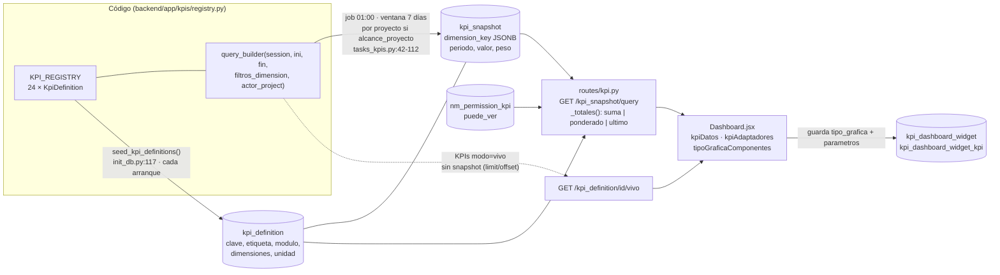
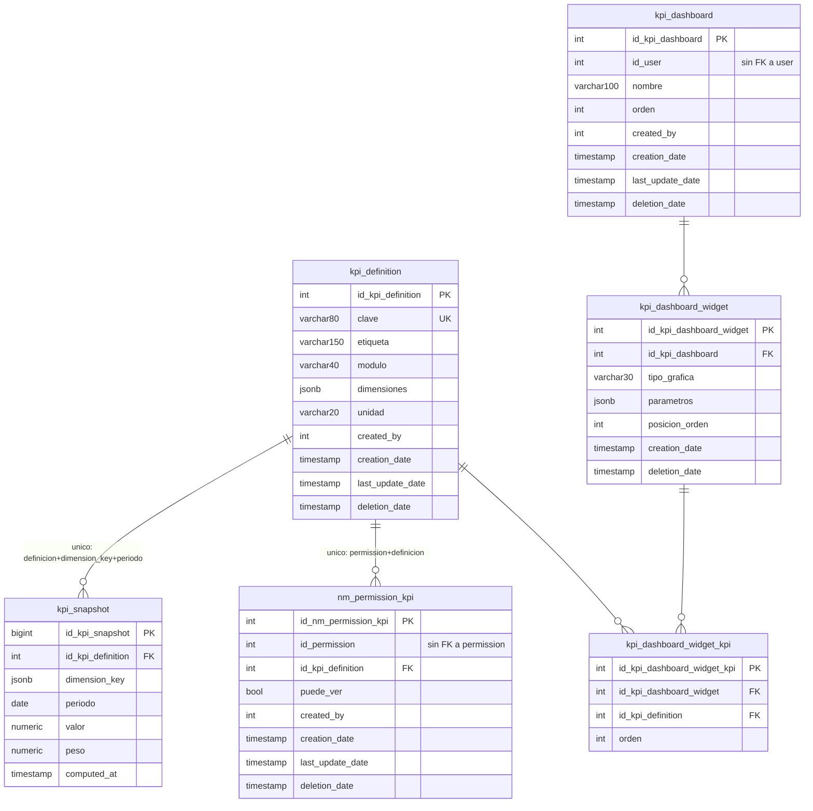

# Arquitectura del módulo de KPIs — estado actual y extensión a nuevas áreas

Rama `initAlan` · análisis del 2026-10-12 · **documento de revisión, sin commit**.

> **Cómo leer este documento.** Todo lo afirmado sale de leer código (referencia
> `archivo:línea`) o de consultar el esquema real con `SELECT`/`\d` (sesión de
> solo lectura, `default_transaction_read_only=on`). Lo que no se pudo comprobar
> está marcado **NO VERIFICADO**.
>
> **Alcance de los datos.** Los conteos de filas vienen de la base **local de
> Docker** (`tyakxa-db-1`, base `tyakxa_erp`), que es una base de desarrollo. No
> se tocó ningún ambiente (`adser-prod`, `tyakxa-dev`, k3s), así que **no hay
> ninguna afirmación sobre volumen de datos reales de clientes**. No se ejecutó
> la API, el job nocturno ni el navegador: el comportamiento descrito sale de la
> lectura del código, no de una corrida.

## Tabla de contenido

- [0. Resumen ejecutivo](#0-resumen-ejecutivo)
- [Parte 1 — Arquitectura actual (as-is)](#parte-1--arquitectura-actual-as-is)
  - [1.1 Pipeline capa por capa](#11-pipeline-capa-por-capa)
  - [1.2 Diagramas](#12-diagramas)
  - [1.3 Anatomía de un `KpiDefinition`](#13-anatomía-de-un-kpidefinition)
  - [1.4 Alcance y multi-tenencia](#14-alcance-y-multi-tenencia)
  - [1.5 Supuestos "por empleado" cableados](#15-supuestos-por-empleado-cableados)
  - [1.6 Checklist: agregar un KPI hoy](#16-checklist-agregar-un-kpi-hoy)
  - [1.7 Deuda técnica y riesgos](#17-deuda-técnica-y-riesgos)
- [Parte 2 — Extensión a nuevas áreas (to-be)](#parte-2--extensión-a-nuevas-áreas-to-be)
  - [2.0 Inventario real de lo que existe](#20-inventario-real-de-lo-que-existe)
  - [2.1 Restaurante](#21-restaurante)
  - [2.2 Logística](#22-logística)
  - [2.3 Recursos Humanos](#23-recursos-humanos)
  - [2.4 Finanzas](#24-finanzas)
  - [2.5 Punto de Venta](#25-punto-de-venta)
  - [2.6 Nóminas](#26-nóminas)
  - [2.7 Checadas de asistencia (operaciones)](#27-checadas-de-asistencia-operaciones)
- [Parte 3 — Arquitectura objetivo](#parte-3--arquitectura-objetivo)
  - [3.1 Organizar `KPI_REGISTRY`](#31-organizar-kpi_registry-para-6-áreas)
  - [3.2 Generalizar la dimensión](#32-generalizar-la-dimensión-por-empleado)
  - [3.3 Eje de tenencia](#33-eje-de-tenencia-logística-y-el-vacío-de-id_proyect)
  - [3.4 Contrato de "KPI plug-in"](#34-contrato-mínimo-de-kpi-plug-in)
  - [3.5 Plan por fases](#35-plan-de-implementación-por-fases)
- [Decisiones abiertas](#decisiones-abiertas)
- [Apéndice: NO VERIFICADO](#apéndice-no-verificado)

---

## 0. Resumen ejecutivo

1. El pipeline es **registro en código → `kpi_definition` (resiembra en cada
   arranque) → job nocturno → `kpi_snapshot` (JSONB) → `/kpi_snapshot/query` →
   `Dashboard.jsx`**. Hay 24 KPIs (24 filas en `kpi_definition` local, 24
   `KpiDefinition(` en `registry.py`). 15 son `alcance_proyecto=False`, 9 son
   por proyecto.
2. El motor ya es casi genérico en backend (`DIMENSION_JSON_KEY`,
   `entidades`), pero **tres cosas lo atan a "empleado"**: el recorte por
   alcance de lectura (`routes/kpi.py:394`), los selectores de etiqueta del
   frontend que cargan `GET /user/` y `GET /product/` completos
   (`Dashboard.jsx:695-697`) y el filtro de empleados que se ofrece para
   cualquier KPI (`Dashboard.jsx:2022`).
3. **Logística no tiene ninguna columna `id_proyect`** (ni en sus 21 tablas) y
   su CRUD no filtra por tenencia. No encaja en el modelo de tenencia del motor.
4. **POS ya vive en la base núcleo**: la base `pos_enterprise` no existe
   (`\l` solo lista `postgres`, `tyakxa_erp`, `tyakxa_kpi_test`) y la migración
   `20260911100000` absorbió 16 tablas. El docstring de `modules/registry.py`
   sigue diciendo lo contrario.
5. **Nómina ya tiene tablas y CRUD** (`payroll_*`, módulo `rh`), pero sin
   servicio de cálculo y con una sola fila placeholder. Finanzas **no es un
   módulo**: sus tablas viven en `facturacion`.
6. Los dos documentos que se mencionan como punto de partida
   (`claude/plan-expansion-multimodulo-kpis.md` y
   `claude/catalogo-kpis-reglas-negocio.md`) **no existen** en el repo, en
   ninguna rama ni en el historial. Los candidatos de KPIs vienen de tu
   mensaje, no de esos archivos.

---

# Parte 1 — Arquitectura actual (as-is)

## 1.1 Pipeline capa por capa

| # | Capa | Archivos | Responsabilidad |
|---|---|---|---|
| 1 | Registro | `backend/app/kpis/registry.py` (2239 líneas) | Declara qué se mide y cómo se calcula. |
| 2 | Catálogo en BD | `registry.py:2210-2239`, `backend/init_db.py:114-122`, `models/kpi_definition.py` | Una fila por KPI, sembrada desde el registro. |
| 3 | Job nocturno | `backend/app/jobs/tasks_kpis.py`, `jobs/beat_schedule.py:8-11` | Calcula y escribe `kpi_snapshot`. |
| 4 | Snapshot | `models/kpi_snapshot.py` | Caché diaria por (KPI, `dimension_key`, día). |
| 5 | Permisos | `utils/auth.py:105`, `models/nm_permission_kpi.py`, `routes/permission_kpi.py`, `utils/scope.py`, `scripts/seed_kpi_permissions.py` | Quién ve qué KPI y de quién. |
| 6 | API | `routes/kpi.py` (584 líneas) | Catálogo, consulta de snapshots, KPIs "vivos", tableros. |
| 7 | UI | `frontend/src/pages/Dashboard.jsx` (2189 líneas), `frontend/src/kpi/*`, `components/kpi-widgets/*` | Editor y render de tarjetas. |

### Capa 1 — Registro (`registry.py`)

- **Vocabularios cerrados** (revientan al importar si un KPI declara otro valor):
  `DIRECCIONES` `:80`, `GRAFICAS` `:87`, `MODOS` `:97`, `UNIDADES` `:103`,
  `DIMENSIONES` `:107`, `AGREGACIONES` `:125`.
- **`DIMENSION_JSON_KEY`** (`:57-71`): traduce tipo de dimensión → llave dentro de
  `dimension_key`: `empleado→id_user`, `producto→id_product`, `global→None`,
  `estado→estado`, `familia→id_familia`.
- **Clase `KpiDefinition`** (`:1610-1692`): descriptor en código. No confundir
  con el modelo ORM homónimo `models/kpi_definition.py` (el propio docstring lo
  avisa, `:10-14`).
- **`query_builder`**: función `(session, fecha_inicio, fecha_fin,
  filtros_dimension, actor_project) -> list[tuple]`. Contrato de retorno:
  `(entidad, fecha, valor)` o `(entidad, fecha, valor, peso)` para
  `promedio_ponderado` (`tasks_kpis.py:82-94`). Dimensión `global` devuelve
  `entidad=None` (`registry.py:674`).
- **Mapas derivados** (`:2086-2107`): `ALCANCE_PROYECTO_POR_CLAVE`,
  `DIMENSION_POR_CLAVE` (usa solo `dimensiones[0]`), `LIMITE_POR_CLAVE`,
  `AGREGACION_POR_CLAVE`, `KPI_POR_CLAVE`.
- **`_validar()`** (`:2128-2207`): clave única, módulo existente en `MODULOS`,
  etiqueta de dimensión de 1–30 caracteres, vocabularios, coherencia
  `modo`/`agregacion`/`resumen_builder`, coherencia
  `orden_categorias`/`colores_categoria`, `grafica_default ∈ graficas_permitidas`.
- **Acoplamiento a otros módulos**: importa modelos de 12 módulos y funciones
  **privadas** de `warehouse_voucher_service` (`_estado_del_renglon`,
  `_vales_de_baja`; `:46-48`).

### Capa 2 — `kpi_definition`

- `seed_kpi_definitions(engine)` hace `INSERT … ON CONFLICT (clave) DO UPDATE`
  de `etiqueta, modulo, dimensiones, unidad` (`registry.py:2217-2239`). **Solo
  esos 4 campos viven en la tabla**; dirección, gráficas, modo, colores, orden,
  límite, descripción, etiqueta de dimensión y `alcance_proyecto` viven solo en
  memoria y se mezclan en `_con_metadatos_del_registry` (`routes/kpi.py:253-278`).
- Se invoca desde `init_db.py:117-120` dentro de un `try/except` **no fatal**:
  si falla, solo imprime un aviso.
- La siembra **nunca borra**: un KPI retirado del registro deja su fila
  huérfana; la API la tolera con valores neutros (`routes/kpi.py:261-278`).

### Capa 3 — Job nocturno

- `beat_schedule.py:8-11`: `recalculate_kpi_snapshots` a las 01:00.
- `VENTANA_DIAS = 7` (`tasks_kpis.py:18`): solo recalcula los últimos 7 días.
  Para historia hay que correr `scripts/recalculate_kpi_snapshots_range.py`
  (`tasks_kpis.py:133`).
- Bucle (`:42-112`): por cada KPI `snapshot`; si `alcance_proyecto`, itera **todos
  los `Proyect` no borrados** (`:38-40`, `:77`), si no, una sola vez con `None`.
  Llama `kpi.query_builder(session, ini, fin, {}, id_proyect)` (`:80`) — el
  cuarto argumento es **siempre `{}`**.
- Escribe `dimension_key = {id_proyect?, <llave de entidad>?}` (`:95-99`) con
  `INSERT … ON CONFLICT ON CONSTRAINT uq_kpi_snapshot_dia DO UPDATE`
  (`:100-111`). Es **solo upsert**: nunca borra filas.
- Los KPIs `vivo` se saltan (`:43-51`).
- La corrida frecuente (`recalculate_kpi_snapshots_frecuentes`, cada 5 min, solo hoy) elige por **módulo**
  (`MODULOS_FRECUENTES`) **y por clave de KPI** (`KPIS_FRECUENTES`, `app/kpis/frecuencia.py`): un KPI entra si su
  módulo o su clave están. Sirve para meter cinco KPIs de checadas de `operaciones` sin recalcular el resto del módulo (§2.7).

### Capa 4 — `kpi_snapshot`

Tabla real (`\d kpi_snapshot`): `id_kpi_snapshot bigint PK`, `id_kpi_definition
int FK`, `dimension_key jsonb NOT NULL`, `periodo date NOT NULL`, `valor numeric
NOT NULL`, `peso numeric NULL`, `computed_at timestamp`. Único
`uq_kpi_snapshot_dia (id_kpi_definition, dimension_key, periodo)`; índice
`idx_kpi_snapshot_lookup (id_kpi_definition, periodo)`. **No hay índice GIN
sobre `dimension_key`**, y las consultas filtran con `@>` y `->>`
(`routes/kpi.py:154`, `:115`) — NO VERIFICADO el impacto con volumen real.

Ejemplo real local: `{"estado": "0-30"}`, `{"id_user": 13}`, `{}` (global).

### Capa 5 — Permisos (3 filtros en serie)

1. **Módulo del plan** — `has_kpi_permission` exige `modulo_habilitado(kpi.modulo)`
   (`utils/auth.py:105-132`), el módulo **del KPI**, no el módulo `kpis`.
2. **Rol por KPI** — fila viva en `nm_permission_kpi` con `puede_ver`
   (`auth.py:142-147`). Superusuario/bootstrap pasa directo (`auth.py:36-37`).
3. **Alcance de lectura** — `owner_ids(scope_bits(…'kpi_definition','read'))`
   (`routes/kpi.py:392-396`); ver §1.4.

Además el endpoint exige `require_entity_permission('kpi_definition','read')`
(módulo `kpis`, hoy solo Administrator: `modules/registry.py:450`).

`nm_permission_kpi` (BD real): `id_permission int NOT NULL` **sin FK a
`permission`**, `id_kpi_definition` FK, `puede_ver bool`, único
`(id_permission, id_kpi_definition)`. Se siembra con
`scripts/seed_kpi_permissions.py`; **solo existe el perfil `adser`**
(`:78`, único rol: Administrator). Local: 2 filas.

### Capa 6 — API (`routes/kpi.py`)

| Endpoint | Línea | Contrato |
|---|---|---|
| `GET /kpi_definition/` | `:281` | Catálogo filtrado por `has_kpi_permission`; devuelve fila BD + metadatos del registro. |
| `GET /kpi_definition/all` | `:297` | Catálogo completo para la pantalla de permisos (`/kpi_permissions`). |
| `GET /kpi_snapshot/query` | `:329` | Params: `id_kpi_definition`, `fecha_inicio/fin`, `fecha_inicio_b/fin_b`, `empleados`\|`entidades`, `id_departments`, `id_teams`, `agrupar_por=entidad\|periodo`. Devuelve `{rango_a, rango_b}`, cada uno `{inicio, fin, total, por_empleado{id:valor}, por_periodo{fecha:valor}[, etiquetas]}`. |
| `GET /kpi_definition/<id>/vivo` | `:434` | KPIs `vivo`: llama `query_builder` en caliente con `limit/offset/id_user/q/orden/…` (firma **distinta**). |
| CRUD `/kpi_dashboard`, `/kpi_dashboard_widget` | `:519-584` | Tableros privados por dueño. |

`_totales()` (`:118-234`) combina snapshots según `agregacion`: `suma`,
`promedio_ponderado` (`Σ valor·peso / Σ peso`) y `ultimo` (foto del último día
con datos); aplica `limite_categorias` después de combinar (`:231-233`).

### Capa 7 — Frontend

- `Dashboard.jsx` arma el editor y las tarjetas. Carga catálogo, usuarios,
  departamentos y **todos los productos** (`:692-699`).
- Una consulta `/kpi_snapshot/query` **por cada KPI del widget**
  (`Dashboard.jsx:1142`).
- Lógica pura (testeable con `node --test`) en `frontend/src/kpi/`: `kpiDatos.js`
  (etiquetas, colores, `buildSeriesData`, `buildPieData`), `kpiAdaptadores.js`
  (props por tipo de gráfica), `kpiParametros.js` (borrador ↔ `parametros`),
  `kpiSelector.js`, `kpiRango.js`.
- Mapa `tipo_grafica → componente`:
  `components/kpi-widgets/tipoGraficaComponentes.js:9-16` (`numero, barras,
  linea, area, tabla, dona`).
- `colorDeKpi(id)` = `CATEGORICAL[id % 8]` (`kpiDatos.js:78`); override por
  widget en `parametros.colores_kpi`.
- Un widget guarda `tipo_grafica` + `parametros` (JSONB) + KPIs en la tabla
  puente `kpi_dashboard_widget_kpi`.

## 1.2 Diagramas

### Flujo de datos



### ER solo del módulo de KPIs (columnas reales de la base)



Local: 24 definiciones, 3038 snapshots (10 KPIs con datos), 2 permisos, 23
tableros, 127 widgets.

## 1.3 Anatomía de un `KpiDefinition`

Constructor en `registry.py:1610-1615`. "Obligatorio" = sin valor por omisión
efectivo; "dónde se valida" cuando aplica.

| Campo | Oblig. | Qué es | Quién lo consume |
|---|---|---|---|
| `clave` | sí | Identidad única (≤80, columna `String(80)`). | BD (`UNIQUE`), `KPI_POR_CLAVE`, permisos por nombre, hardcodes de frontend (§1.5). Validado `_validar:2130`. |
| `etiqueta` | sí | Nombre visible (≤150). | `kpi_definition.etiqueta`, selector. |
| `modulo` | sí | Clave de `MODULOS` (`modules/registry.py`). | `has_kpi_permission` (plan), agrupación del selector, `kpi_definition.modulo`. Validado `:2133`. |
| `dimensiones` | sí | Tupla; **solo `[0]` se usa**. | `DIMENSION_POR_CLAVE:2093`, job `:62`, ruta `:379`, frontend `dimensiones?.[0]`. |
| `query_builder` | sí | Función de cálculo. | Job (snapshot) o ruta vivo. |
| `direccion` | sí (kwarg sin default) | `alto_es_mejor`/`bajo_es_mejor`/`neutral`. | Frontend: color de la flecha de variación. |
| `graficas_permitidas`, `grafica_default` | sí | Subconjunto de `GRAFICAS`. | Editor (intersección entre KPIs, `kpiParametros.js:144`). |
| `agregacion` | sí si `modo=snapshot`; prohibida si `vivo` | `suma`/`promedio_ponderado`/`ultimo`. | `_totales()`. Validado `:2147-2156`. |
| `unidad` | no (`"numero"`) | `numero/porcentaje/moneda/dias/piezas`. | BD, `UNIDAD_INFO` frontend, regla de no mezclar unidades (`motivoParaNoCombinar`, `kpiParametros.js:175`). |
| `alcance_proyecto` | no (`True`) | ¿se calcula/filtra por proyecto? | Job `:77`, ruta `:377-378`, `seed_kpi_permissions` (validación). |
| `modo` | no (`snapshot`) | `snapshot`/`vivo`. | Job, ruta vivo, frontend (`tabla`). |
| `colores_categoria` | no | `{categoría: "#hex"}` para dimensión `estado`. | Frontend (`kpiAdaptadores.js:82`). |
| `orden_categorias` | no | Lista ordinal. | Frontend `ordenarPorCategorias`. |
| `limite_categorias` | no | Top-N de dimensión abierta. | `_totales:231`. |
| `etiqueta_dimension` | no (por omisión según dimensión) | "Responsable", "Técnico"… | Editor "Agrupar por". |
| `descripcion` | no | Línea del selector. | Selector. |
| `resumen_builder` | no; solo `vivo` | Agregados de la tabla viva. | Ruta vivo `:497`. |

## 1.4 Alcance y multi-tenencia

**Eje de tenencia actual: `id_proyect`**, tomado del JWT del actor
(`user_data['id_proyect']`). `user.id_proyect` es `NOT NULL` en la base.

Decisión por petición (`routes/kpi.py:376-409`), en este orden:

1. **Superusuario / bootstrap** (`is_superuser` o `is_bootstrap_admin`):
   `actor_project=None` → suma **todos** los proyectos
   (`invoice_service.py:47-63`).
2. **No superusuario, KPI con `alcance_proyecto=True`**: `actor_project =
   user_data.id_proyect`; si falta o es 0 → `403 errors.project_scope_required`
   (`invoice_service.py:56-62`). El filtro viaja como
   `dimension_key @> {"id_proyect": N}` (`routes/kpi.py:153-154`).
3. **No superusuario, KPI con `alcance_proyecto=False`**: `actor_project=None`
   → ve **toda la empresa** sin límite de proyecto.
4. **Alcance de lectura del rol** (`Propios`/`Mis grupos`/`Todos`, fase 1 de
   permisos): si no es `Todos`, solo funciona con dimensión `empleado` y
   recorta `entidades` a `owner_ids(...)`; con cualquier otra dimensión
   → `403 reason: scope` (`:392-396`). `kpi_definition` está en
   `ENTIDADES_CON_ALCANCE_DE_DUENO` (`scope.py:144`).
5. `id_departments` se traduce a usuarios vía `Permission.id_department`
   (`:89-102`, `:404-409`), solo para `empleado`.

**KPIs sin `id_proyect` (15 de 24)**: el job los calcula una vez y **no escribe
`id_proyect`** en el snapshot (`tasks_kpis.py:77,96`). Consecuencia verificada
por lectura: **la única barrera** que impide que un rol acotado a proyecto vea
datos de toda la empresa es `scripts/seed_kpi_permissions.py`
(`acotado_a_proyecto` + `validar`); la API `POST /permission_kpi/` no valida
nada (`routes/permission_kpi.py:122-128`), así que alguien con permiso sobre
`nm_permission_kpi` puede asignar un KPI sin proyecto a un rol acotado desde la
pantalla `/kpi_permissions`.

**Dónde existe `id_proyect` en la base** (consulta a `information_schema`):

| Entidad | `id_proyect` | Nota |
|---|---|---|
| `invoice` | **nullable** | Alta manual lo exige (`manual_invoice_service.py:200`); importadas/legadas pueden ir en NULL y **nunca entran** a un snapshot por proyecto (el job itera proyectos y compara por igualdad). Alcance real: NO VERIFICADO. |
| `incident` | **nullable** (existe) | Agregada por `20260911180000_el_proyecto_de_taller.sql:140`; los 49 incidentes locales la tienen en NULL. `warehouse_voucher_service.py:674` la acepta opcional. |
| `nm_incident_product` | no existe | Se llega vía `incident`. |
| `inventory_stock`, `inventory_lot`, `inventory_asset`, `inventory_asset_event`, `location` | no existe | |
| `inventory_ledger` | `NOT NULL` | Única tabla de inventario con proyecto. |
| `task`, `proyect*`, `laboratory_*`, `document`, `restaurant_*` (salvo `restaurant_order_item`), `pos_*` | `NOT NULL` | |
| **`logistics_*` (21 tablas)** | **ninguna** | Ver §2.2. |
| `payroll_*` | **ninguna** | Se llega por `user.id_proyect`. |

> Los comentarios del registro afirman que `Incident` y el inventario no tienen
> `id_proyect` "en ningún punto de la cadena" (`registry.py:302-308`,
> `:383-385`, `:721-724`). Ya no es exacto para `incident` ni `inventory_ledger`.

## 1.5 Supuestos "por empleado" cableados

**Backend**

| Dónde | Qué asume |
|---|---|
| `routes/kpi.py:394-396` | Recorte por alcance de lectura **solo** para `dimension == 'empleado'`; cualquier otra → 403. Un KPI "por mesero" o "por unidad" quedaría inaccesible para cualquier rol que no tenga `Todos`. |
| `routes/kpi.py:380` | `DIMENSION_JSON_KEY.get(dimension, 'id_user')` — por omisión, `id_user`. |
| `routes/kpi.py:404-409` | `id_departments → id_user` solo para `empleado`. |
| `routes/kpi.py:338-344` | Parámetro `empleados` tiene prioridad sobre `entidades`; nombre histórico. |
| `routes/kpi.py:227`, `:220-230` | Las filas con entidad `NULL` se descartan **del listado y del total**. Un pedido de restaurante sin mesero, p. ej., desaparecería. |
| `routes/kpi.py` respuesta `por_empleado` | Nombre histórico para cualquier entidad (comentario `routes/kpi.py:126-129`). |
| `tasks_kpis.py:62` | `DIMENSION_JSON_KEY.get(dim, "id_user")`. |
| `registry.py` (≈14 queries) | `filtros_dimension["empleados"]`/`["productos"]` — **código muerto en la ruta real**: el job pasa `{}` (`tasks_kpis.py:80`) y el recorte real ocurre al leer. |
| `registry.py:57-71`, `:107`, `:1601` | Tres tablas paralelas de dimensiones (llave JSON, vocabulario, etiqueta). |
| `registry.py:2093` | Solo `dimensiones[0]`. |

**Frontend**

| Dónde | Qué asume |
|---|---|
| `Dashboard.jsx:695-697` | Carga `getAllUser({per_page:500})` → `GET /user/` (requiere `user:read`, módulo seguridad: `routes/user.py:432-434`) y `getAllProduct({per_page:5000})`. Un rol de negocio con KPIs recibiría la lista vacía y etiquetas `#id`. Ya existe `GET /user/options` sin ese permiso (`routes/user.py:418`, `api/index.js:820`). |
| `Dashboard.jsx:701-710` | `userLabel`/`productLabel` por búsqueda en esas listas. |
| `kpiDatos.js:95-106` | `labelForDimension`: `producto→productLabel`, `familia→etiquetas`, `global→"Total"`, `estado→capitalizar`; **todo lo demás cae en `userLabel`**. |
| `kpiDatos.js:127`, `:120-126` | Lee `por_empleado`. |
| `kpiDatos.js:199` | `DIMENSIONES_ABIERTAS = {empleado, producto}` decide si la dona agrupa "Otros"; `familia` (abierta) ya no está. |
| `Dashboard.jsx:2022` | El selector de empleados se muestra con solo `users.length > 0`, **sin mirar la dimensión del KPI** (la demo sí: `AgregarGraficoDemo.jsx:70`). Con un KPI de dimensión `estado`, `_totales` compara `estado` contra ids de usuario (`routes/kpi.py:162`) y devolvería vacío. Por lectura; NO reproducido. |
| `kpiParametros.js:62`, `:118` | El parámetro guardado se llama `empleados`. |
| `kpiAdaptadores.js:46` | `por_empleado`. |
| `Dashboard.jsx:1494`, `:1542`, `:1602` | Comportamiento ligado a `clave` literal: `articulos_bajo_stock`, `incidencias_abiertas_por_empleado`. |
| `Dashboard.jsx:104-110`, `kpiSelector.js:19`, `:74-81`, `AgregarGraficoDemo.jsx:15-20,40` | Tres listas distintas de módulos (etiqueta/icono, orden, color). Un módulo nuevo (`restaurante`, `logistica`, `rh`) cae al icono genérico y a la etiqueta capitalizada, y se ordena al final. |

## 1.6 Checklist: agregar un KPI hoy

1. **Query** en `backend/app/kpis/registry.py`: función con la firma de cinco
   argumentos, filtro `deletion_date IS NULL`, fecha de negocio explícita,
   respeto de `actor_project` si aplica. Devolver `(entidad, fecha, valor[, peso])`.
2. **Declarar** el `KpiDefinition(...)` en `KPI_REGISTRY` (`:1705-2078`) con
   `direccion`, `graficas_permitidas`, `grafica_default`, `agregacion`,
   `alcance_proyecto`, `unidad`.
   Si es una dimensión nueva: sumarla a `DIMENSIONES` `:107`, `DIMENSION_JSON_KEY`
   `:57` y `ETIQUETA_DIMENSION_POR_OMISION` `:1601`.
3. **Módulo**: debe existir en `MODULOS` (`modules/registry.py:114`); si es
   nuevo, además `ROLES` (`:447-…`) y menú.
4. **Catálogo en BD**: no hay migración; `init_db.py` resiembra al arrancar.
   Reiniciar el backend. (Si el seed falla solo imprime un aviso.)
5. **Backfill**: la tarea nocturna solo cubre 7 días →
   `python scripts/recalculate_kpi_snapshots_range.py <ini> <fin>`
   (`tasks_kpis.py:133`). Un KPI `vivo` no lo necesita.
6. **Permisos**: agregar la clave a `ASIGNACIONES` en
   `scripts/seed_kpi_permissions.py:78` (hoy solo existe el perfil `adser`) y
   correrlo con `--dry-run` primero; o asignar desde `/kpi_permissions`. Sin
   fila, solo el superusuario lo ve.
7. **Frontend**: normalmente nada si reutiliza dimensión/gráficas. Si el módulo
   es nuevo: `KPI_MODULE_META` (`Dashboard.jsx:104`), `ORDEN_DE_MODULOS` y
   `COLOR_DE_MODULO` (`kpiSelector.js:19,74`). Si la dimensión es nueva:
   `labelForDimension` y `DIMENSIONES_ABIERTAS` (`kpiDatos.js`).
8. **Pruebas** (patrón de `test_kpi_incidentes.py`, ids 970+, `skipUnless
   postgresql`, bootstrap `user=1, proyect=1, status=1, customer_supplier=1`):
   `backend/tests/test_services/test_kpi_<tema>.py`; si cambia la API,
   `tests/test_api/test_api_kpi*.py`; metadatos en
   `test_kpi_metadata_del_registry.py`. Correrlas con
   `backend/ci/run_postgres_tests.sh -k kpi` (en SQLite se **saltan en
   silencio**, y ningún CI las corre: `backend/tests/README.md`).
9. **Despliegue**: nota en `docs/despliegues/` y, si el KPI cambia números ya
   mostrados, backfill con aprobación (regla 4 de `CLAUDE.md`).

## 1.7 Deuda técnica y riesgos

Ordenados por impacto. "Por lectura" = deducido del código sin reproducirlo.

| # | Hallazgo | Evidencia | Qué rompe un KPI nuevo |
|---|---|---|---|
| D1 | **Snapshots huérfanos (por lectura).** El job solo hace upsert; si una factura se cancela y el grupo (empleado, día) deja de existir, la fila vieja sigue con su valor durante y después de la ventana. | `tasks_kpis.py:100-111` (sin `DELETE`). | Cualquier KPI de eventos con correcciones retroactivas (restaurante: pedido anulado; logística: viaje reasignado). |
| D2 | **Entidad `NULL` desaparece (por lectura).** | `routes/kpi.py:220-230`. | Pedidos sin mesero, viajes sin operador/unidad (`id_logistics_unit` es nullable). |
| D3 | **Fuga de alcance fuera del seed.** *(Parcialmente atendido el 2026-10-12: `NmPermissionKpiService` rechaza asignar un KPI sin eje de proyecto a un rol sin alcance Todos. **Q1 sigue abierta**, ver "Limitación de D3" abajo.)* | §1.4, `routes/permission_kpi.py:122`. | Todo KPI nuevo con `alcance_proyecto=False` en un despliegue con varios proyectos. |
| D4 | **`filtros_dimension` código muerto** y la firma difiere entre `snapshot` y `vivo`. | `tasks_kpis.py:80`, `routes/kpi.py:493`. | Confunde al autor de KPIs nuevos; ~14 queries lo repiten. |
| D5 | **Comentarios desactualizados** sobre `id_proyect` de `Incident`/inventario. | §1.4. | Decisiones de alcance basadas en una premisa falsa. |
| D6 | **Registro monolítico** (2239 líneas) con imports privados cruzados. La auditoría ya lo señala. | `registry.py:46-48`; `auditoria/AUDITORIA_FINAL_2026-10-08.md:117`. | Cada área nueva suma modelos y reglas al mismo archivo. |
| D7 | **Reglas de negocio duplicadas** ("venta vigente", "renglón abierto/baja"). | `registry.py:161,198,662,691`; auditoría `:71,77`. Regla 3 de `CLAUDE.md`. | Un KPI de restaurante/POS/finanzas repetiría "qué es una venta" por cuarta vez. |
| D8 | **Tres listas de módulos en frontend** y claves literales en `Dashboard.jsx`. | §1.5. | Módulo nuevo = icono genérico/orden al final. |
| D9 | **Frontend carga `GET /user/` y `GET /product/` (hasta 5000) en cada montaje.** | `Dashboard.jsx:695-697`. | Etiquetas rotas para roles sin permiso de usuarios; carga innecesaria. |
| D10 | **Seed del catálogo no fatal.** | `init_db.py:117-122`. | KPI nuevo no aparece y solo hay un `print`. |
| D11 | **Solo los perfiles `adser` y `comala` en `ASIGNACIONES`** (`comala`, agregado el 2026-10-20, está escrito y probado pero **no se ha aplicado a ninguna base**); local con 2 filas. | `seed_kpi_permissions.py:78`. | KPIs de áreas nuevas serían invisibles salvo para superusuario. |
| D12 | **`nm_permission_kpi.id_permission` y `kpi_dashboard.id_user` sin FK.** | `\d` de ambas. | Huérfanos al borrar roles/usuarios. |
| D13 | **Los KPIs saltan los permisos por campo** (`nm_field_permission`). | `routes/kpi.py` completo: no los consulta. | KPIs de nómina/salario expondrían montos a quien tenga `puede_ver`. |
| D14 | **Tests de KPI solo en Postgres y sin CI.** | `tests/README.md`. | Un KPI nuevo puede romperse sin que la suite normal lo note (188 saltadas). |
| D15 | **Nombre duplicado `KpiDefinition`** (descriptor vs ORM). | `registry.py:10-14`; ambos importados en `routes/kpi.py:13`. | Import equivocado silencioso. |
| D16 | **Comentario "16 KPIs de siempre"** frente a 24 reales. | `registry.py:1633,1695`, `routes/kpi.py:306`. | Menor; confunde. |
| D17 | **Variación del lenguaje de `ultimo` con global**: si no hay fila del último día, toma el día anterior. | `registry.py:937-943` (resuelto allí con `generate_series`). | Cualquier KPI de foto nuevo debe repetir ese truco. |

**Limitación de D3 (Q1, pendiente).** La regla implementada
(`backend/app/services/nm_permission_kpi_service.py`, `exigir_eje_de_proyecto`) es
una **aproximación**: "rol acotado a proyecto" **no existe como dato**. Lo que sí
pasa en ejecución es que todo usuario que no es superusuario queda acotado a su
`id_proyect` (`invoice_service.py:47-63`), con cualquier rol. Se tomó como "acotado"
al rol que **no** tiene alcance *Todos* (bit 4) sobre `kpi_definition`. Consecuencias:
(1) un rol con *Todos* recibe KPIs sin eje de proyecto y sus usuarios ven toda la
empresa con ellos; (2) un rol sin fila de `kpi_definition` también se rechaza;
(3) la bandera manual `acotado_a_proyecto` de `scripts/seed_kpi_permissions.py` es
una segunda regla que puede discrepar. Pendiente: que el equipo defina "rol
acotado a proyecto" (ver *Decisiones abiertas*, punto 13).

---

# Parte 2 — Extensión a nuevas áreas (to-be)

## 2.0 Inventario real de lo que existe

**Módulos** (`modules/registry.py:114-248`): `facturacion, inventario, compras,
operaciones, logistica, restaurante, pos, crm, documentos, laboratorio, rh, kpis,
configuracion, seguridad`. **No existe `finanzas` ni `nominas`.**

**Conteos locales exactos** (`SELECT count(*)`; base de desarrollo): todas las
tablas `restaurant_*` (6 contadas exactas: cash_session, order, visit, waiter,
dish, order_item) = 0; `logistics_*` (trip, shipment, unit, maintenance,
receivable, operator, incident) = 0; `pos_*` (sale, sale_item, cash_session,
expense, payment) = 0; `invoice`=1, `invoice_payment`=0, `bank_statement*`=0,
`payroll_*`=1 cada una (placeholder, ver §2.3); `user`=6; `incident`=49;
`nm_incident_product`=32. El resto de tablas `restaurant_*`/`logistics_*`/
`pos_*` figuran en 0 según `pg_stat_user_tables` (estimado, no exacto).

> **Consecuencia:** localmente no hay dato utilizable de restaurante,
> logística, POS, finanzas ni nómina. "¿El dato es utilizable?" respecto a
> clientes reales es **NO VERIFICADO**.

**Estados válidos confirmados** (CHECKs de la base o constantes del servicio):

- `restaurant_order.status`: `borrador→pedido→en_preparacion→listo_para_entrega→entregado→pagado`
  (`restaurant_service.py:43-48`; `pagado` lo fija el cobro, `:676,:771`).
- `pos_sale.sale_status`: `open, suspended, paid, cancelled, refunded,
  partially_refunded` (`ck_pos_sale_status`); `pos_cash_session.session_status`:
  `open, closed_x, closed_z` (`pos_service.py:216`).
- `logistics_trip.status`: 11 valores incluidos `entregado, cerrado, facturado,
  cancelado` (`logistics_trip_status_check`).
- `logistics_maintenance.status`: `abierta, en proceso, cerrada`; con CHECK que
  obliga `closed_at` no nulo si `cerrada`.
- `logistics_receivable.status`: `pendiente, pagado, vencido` — **ningún código
  escribe `vencido`** (solo la restricción del modelo): hay que calcularlo por
  `due_at`.
- `invoice.invoice_direction`: `venta, compra, sin_clasificar`;
  `invoice.source_module ∈ {pos, restaurante, logistica}`.

## 2.1 Restaurante

**Tablas** (13, todas con `id_proyect NOT NULL`, salvo `restaurant_order_item`
que cuelga de la orden): `restaurant_waiter` (`id_restaurant_waiter`, `id_user`
**nullable**, `name`), `restaurant_visit`, `restaurant_order`
(`id_restaurant_waiter` nullable, `tip_amount`, `status`, `sent_at`, `cooked_at`,
`ready_at`, `delivered_at`, `paid_at`, `payment_method`),
`restaurant_order_item` (`quantity`, `unit_price`), `restaurant_cash_session`
(`opened_by_id`, `closed_by_id`, `opening_amount`, `closing_amount`,
`expected_amount`, **`difference`**, `status`), `restaurant_dish`
(`production_cost`), recetas e inventario. Tenencia: `id_proyect` (igual que el
motor actual). Filas locales: 0.

**Hechos de código relevantes**

- El **subtotal no es una columna**: es una propiedad Python
  (`models/restaurant.py:215-217`, `line_total` en `:290-292`). Un KPI SQL debe
  recalcular `quantity * unit_price` uniendo `restaurant_order_item`.
- El servicio ya calcula "KPIs" en vivo por proyecto (`restaurant_service.py:791` `kpis`,
  `:835` `sales_report`), con su propia regla de "venta" =
  `status == 'pagado'`. Hoy dos implementaciones de la misma regla convivirían.
- La diferencia de caja **ya se guarda** al cerrar: `difference = closing -
  expected` (`restaurant_service.py:923`), con `expected` solo del efectivo.

**KPIs viables (verificados contra esquema y servicio; sin datos reales)**

| KPI candidato | Fórmula y fuente | Filtros | Dimensión | Estado |
|---|---|---|---|---|
| `ventas_por_mesero` | `Σ item.quantity × item.unit_price` de `restaurant_order_item` ⨝ `restaurant_order` | `order.status='pagado'`, `order.deletion_date IS NULL`, `item.deletion_date IS NULL`, fecha `paid_at::date` | **`mesero`** (`order.id_restaurant_waiter`), nueva | Viable en esquema; requiere dimensión nueva (§3.2). `suma`, `moneda`. |
| `propinas_por_mesero` | `Σ order.tip_amount` | igual | `mesero` | Viable. `pay_visit` reparte la propina entre órdenes con `_split_exact` (`restaurant_service.py:726-729`), así que la suma por orden cuadra. |
| `diferencia_de_caja` (etiqueta «Desviación de caja») | `Σ abs(restaurant_cash_session.difference)`, el valor absoluto **de cada sesión** y luego la suma (no el absoluto de la suma: +100 y −100 el mismo día dan 200, no 0) | `status='closed'`, `deletion_date IS NULL`, fecha `closed_at::date` | **`empleado`** vía `closed_by_id` (cajero) | **Implementado** (decisión de negocio: sobrante y faltante pesan igual). `bajo_es_mejor`, sin asignar a ningún rol. Conserva la clave `diferencia_de_caja`: el seed no borra filas y un renombre dejaría una huérfana. |
| `tiempo_de_servicio` | promedio de minutos entre dos marcas | órdenes `entregado`/`pagado` con ambas marcas no nulas; peso = nº órdenes (`promedio_ponderado`) | `mesero` o `global` | Viable, pero **"tiempo de servicio" no está definido**: el servicio hoy mide `ready_at→delivered_at` (`restaurant_service.py:819`, bloque `avg_minutes_from_ready_to_delivered`); `sent_at→delivered_at` sería otra cosa. |
| `ticket_promedio` | `Σ subtotal / nº órdenes pagadas` | igual a ventas | `global` | Viable (`promedio_ponderado`). |

**Bloqueos / qué falta**

- Dimensión `mesero` (no existe) y etiquetas de mesero (hoy el frontend solo
  sabe etiquetar usuarios y productos).
- Alcance `Propios/Mis grupos` para `mesero` exige mapear mesero→usuario, y
  `restaurant_waiter.id_user` es nullable.
- Órdenes sin mesero se perderían (D2).
- Fuente única de "qué es una venta de restaurante": extraer una función que
  compartan el servicio y el KPI.

### 2.1.1 Fotos del día en curso y refresco frecuente (implementado)

**Cómo se refrescan los KPIs.** La corrida nocturna (`recalculate_kpi_snapshots`, `crontab(hour=1)`) recalcula una
ventana de 7 días de TODOS los módulos: sin cambios. **Corre a las 01:00 UTC = 19:00 de México**: Celery usa
`CELERY_TIMEZONE`, que vale `UTC` por omisión y ningún archivo del repo fija (`docker-compose.yml` y `k8s/` no la mencionan); verificado el 2026-10-20 en el contenedor local de `celery-beat`
(`celery.conf.timezone = UTC`, próxima corrida 01:00 UTC). Un secreto de un clúster real podría fijarla: no se consultó. Decisión pendiente
documentada en `docs/despliegues/2026-10-15_kpis_restaurante_zona_horaria_y_dia_operativo.md`. Además, `recalculate_kpi_snapshots_frecuentes` recalcula
**solo hoy** y **solo los módulos de `MODULOS_FRECUENTES`** (`restaurante`, `pos`;
`app/kpis/frecuencia.py`) más los KPIs sueltos de `KPIS_FRECUENTES` (§2.7) cada `INTERVALO_MINUTOS_POR_OMISION` = 5 minutos (beat con `timedelta`; la variable
`KPI_FRECUENTES_INTERVALO_MIN`, 1 a 60, solo la sobreescribe; el beat expira cada corrida al llegar la
siguiente para que no se apilen). Una venta de hoy aparece en el Dashboard en ≤ 5 minutos en vez de al día
siguiente. `pos` aún no tiene KPIs: quedó declarado para que los primeros entren sin tocar el job.

| KPI | Fuente | Categorías | Notas |
|---|---|---|---|
| `pedidos_del_dia` (`ultimo`, dimensión `estado`, dona) | `restaurant_order.status`, día de `sent_at` (o `started_at`) = hoy, sin borradores ni borradas | `cobrado` (`pagado`), `entregado_sin_cobrar` (`entregado`), `en_curso` (`pedido`, `en_preparacion`, `listo_para_entrega`) | Excluyentes: la suma es el total de pedidos hechos hoy. Se agrupa por el día en que se HIZO el pedido, no el de cobro. Siempre 3 filas, con 0. Los nombres de categoría salen tal cual (con guion bajo) en el Dashboard. |
| `cuentas_sin_cobrar` (`ultimo`, global, `moneda`) | `Σ` subtotal (`importe_de_renglon`, sin propina) de órdenes `entregado` | — | Saldo de cualquier día, no un periodo. Explica una desviación de caja: consumo entregado que aún no entra a la caja. |
| `mesas_ocupadas` (`ultimo`, dimensión `estado`, dona) | `restaurant_table` (activa) ⨝ `restaurant_visit.status='active'` | `libre`, `ocupada_con_cuenta_pendiente`, `por_liberar` | **La mesa se libera al cerrar la visita (`close_visit`), no al cobrar**: `pay_order`/`pay_visit` no tocan la visita. `por_liberar` («Pagada, aún ocupada») = visita activa con al menos una orden y TODAS pagadas. Un borrador sin partidas se IGNORA (no es una orden ni retiene la mesa; en `pedidos_del_dia` tampoco cuenta); una visita sin órdenes, o con solo borradores vacíos, cuenta como `ocupada_con_cuenta_pendiente`. Las de para llevar no tienen mesa. |

`sin_asignar` no aplica a estas tres: el validador del registro lo prohíbe en dimensiones `global` y
`categoria`, y sus categorías son texto fijo, no entidades que puedan faltar. Una foto sin corrida ese día
sigue mostrando la del último día con filas (agregación `ultimo`).

**NO VERIFICADO:** el rendimiento de la corrida frecuente con volumen real (ver medición local en la
bitácora de la sesión): se midió solo con la base local, casi vacía.

### 2.1.2 Zona horaria y día operativo (implementado 2026-10-15)

**Zona horaria.** Las columnas de evento (`paid_at`, `sent_at`, `delivered_at`, `opened_at`, `closed_at`) se
guardan en UTC. Antes los KPIs agrupaban con `date(columna)`, es decir por día UTC: un cobro a las 19:00 de
México caía en el día siguiente. Ahora todo pasa por `dia_local()` (`app/utils/tiempo.py`), que usa
`APP_TIMEZONE`: en PostgreSQL `CAST(timezone(zona, timezone('UTC', col)) AS DATE)` (con la base de zonas de
Postgres, respeta el horario de verano de cada fecha); en SQLite —solo pruebas— `date(col, '<desfase> minutes')` con el
desfase de la zona al momento de compilar (exacto para America/Mexico_City, UTC-6 fijo). La corrida frecuente fecha
"hoy" con `hoy_negocio()`, no con `date.today()` del contenedor.

**Día operativo.** El día de cada KPI de restaurante es el de la **sesión de caja** que estaba abierta en
ese instante (`restaurant_rules.dia_operativo`): la fecha local de su `opened_at`. Un turno que abre a las 18:00 y cierra a las
02:00 cuenta completo en el día en que abrió. Si ninguna sesión contiene el instante (p. ej. un cobro con
tarjeta o transferencia con la caja cerrada) se usa la fecha calendario local. No hay columnas ni migraciones: ni la
orden ni el cobro guardan la sesión; se vincula por tiempo y proyecto, igual que `close_cash_session`
(`paid_at >= opened_at`), y como solo hay una sesión abierta por proyecto, las sesiones no se traslapan.
La **desviación de caja** pasa de `closed_at` a `opened_at` (el día del turno, no el del cierre).

**Riesgos conocidos.**

1. **Turno abierto varios días.** Una caja que nadie cierra absorbe todo lo que ocurra después en el día en
   que abrió: `closed_at IS NULL` no tiene tope. Las ventas de los días siguientes salen en el día de apertura
   hasta que alguien haga el corte. Medida: cerrar la caja cada día; el gerente ve la sesión abierta en caja.
2. **Cobros sin sesión.** Tarjeta/transferencia con la caja cerrada caen en el día calendario local, no en
   ningún turno. Es lo esperable, pero una venta de las 00:30 con la caja ya cerrada a las 00:00 cuenta en el día nuevo.
3. **Las fotos (`pedidos_del_dia`, `mesas_ocupadas`, `cuentas_sin_cobrar`) se fechan en `hoy_negocio()`** (día
   calendario). Si un turno abierto ayer sigue operando a las 00:30, `pedidos_del_dia` de "hoy" cuenta 0 hasta que abra
   una caja nueva: sus pedidos son del día operativo de ayer. No se corrigió por no ser parte del pedido; es una decisión de
   producto (¿"hoy" del tablero = calendario u operativo?).
4. **Reprocesar el histórico** cambia cifras ya vistas (ventas que se movían de día). `recalcular_kpi_snapshots_rango`
   recalcula todos los módulos y las fotos solo se escriben en `fecha_fin`; las fotos de días pasados no se pueden
   reconstruir. En la base local no había órdenes de restaurante (solo 21 fotos), así que no hubo nada que reprocesar;
   **en producción lo decide Alan** (ver `docs/despliegues/2026-10-15_kpis_restaurante_zona_horaria_y_dia_operativo.md`).
5. **Se cruza con Celery.** Ver el hallazgo de `CELERY_TIMEZONE` en esa misma nota.

**Rendimiento (medido 2026-10-15, base local con datos sintéticos: 200 mil órdenes cobradas de un solo restaurante, 366 sesiones).**
La sesión se busca con una subconsulta correlacionada por orden. Sin cuidado era lenta (8.9 s por un año, 3.1 s por un día);
`restaurant_rules.en_dias_operativos` agrega una ventana de tiempo exacta sobre la columna cruda (derivada de las sesiones que abren
en el rango) para que solo se evalúe en las órdenes del rango.

| Consulta (ticket_promedio) | Sin índice nuevo | Con índice `(id_proyect, opened_at)` en `restaurant_cash_session` |
|---|---|---|
| 1 día (corrida frecuente) | 74 ms | 20 ms |
| 7 días (corrida nocturna) | 385 ms | 85 ms |
| 1 año (backfill) | 19 s | 4.3 s |

Los KPIs por `sent_at`/`delivered_at` (`servicios_por_mesero`, `pedidos_del_dia`) tardan ~350–420 ms por día porque esa columna no
tiene índice. El índice de sesiones **no se creó** (sería una migración; queda como propuesta para Alan). Aceptable por ahora: la
corrida frecuente son decenas de ms a unos cientos de ms por proyecto cada 5 minutos, y el Dashboard lee `kpi_snapshot`.

## 2.2 Logística

**Tablas** (21, todas **sin `id_proyect`**; eje disponible: `id_customer_supplier`
en `logistics_trip`, `logistics_shipment`, `logistics_service_request`,
`logistics_quotation`, `logistics_receivable`, `logistics_contract`).
Columnas clave: `logistics_trip` (`status`, `planned_delivery_at`,
`actual_delivery_at`, `actual_pickup_at`, `planned_cost`, `actual_cost`,
`revenue`, `kilometers`, `id_logistics_unit`/`_operator` nullable);
`logistics_maintenance` (`id_logistics_unit` NOT NULL, `cost`, `status`,
`closed_at`); `logistics_receivable` (`id_invoice`, `amount`, `due_at`,
`status`, `paid_at`); `logistics_shipment` (**sin fecha de entrega**: solo
`status`, `creation_date`, `last_update_date`); `logistics_operator`
(`performance_score`). Filas locales: 0.

**Hechos de código**: el CRUD genérico (`routes/logistics_workflow.py:17-60`) no
filtra por proyecto ni por cliente; cualquiera con el bit de la entidad ve todo.
El comentario de `routes/kpi.py:506-513` dice que logística "se acota por
proyecto", y no es así (ninguna tabla tiene la columna).

**KPIs**

| KPI candidato | Fórmula y fuente | Filtros | Dimensión | Estado |
|---|---|---|---|---|
| `viajes_entregados` (en lugar de "embarques entregados") | `count(logistics_trip)` por `actual_delivery_at::date` | `status IN ('entregado','cerrado','facturado')`, `actual_delivery_at IS NOT NULL`, `deletion_date IS NULL` | `cliente` (`id_customer_supplier`), `operador` o `unidad` | Viable en esquema. **"Embarques entregados" tal como está documentado no es calculable por día**: `logistics_shipment` no tiene fecha de entrega; solo un conteo-foto por `status`. |
| `entregas_a_tiempo` (%) | entregados con `actual_delivery_at <= planned_delivery_at` / entregados | ambas fechas no nulas | `cliente`/`global` | Viable (`promedio_ponderado`, peso = viajes). |
| `cuentas_por_cobrar_vencidas` | `Σ amount` de `logistics_receivable` | `due_at < hoy`, `status IN ('pendiente','vencido')`, `deletion_date IS NULL`. **No usar `status='vencido'`** (nadie lo escribe) | `cliente`; o aging `estado` (patrón de `prestamos_abiertos_por_antiguedad_query`, `registry.py:980`) | Viable; es `ultimo` (foto). |
| `costo_mantenimiento_por_unidad` | `Σ cost` | `status='cerrada'`, fecha `closed_at` (el CHECK garantiza que existe) | `unidad` (`id_logistics_unit`; etiqueta = `plate`) | Viable. |
| `margen_por_viaje` | `Σ (revenue − actual_cost)` | entregados | `cliente`/`unidad` | Viable en esquema; **la regla de "viaje facturado" y la relación con `invoice` no se investigaron**: NO VERIFICADO. |

**Hallazgo: `logistics_receivable` e `invoice_payment` no se sincronizan (verificado en código).**
`LogisticsReceivableService` es un CRUD con validación de dominio (`status` ∈ `pendiente, pagado, vencido`):
ningún código lo enlaza con `invoice_payment`. Registrar un abono (`invoice_payment_service`) no marca la
cuenta como `pagado` ni escribe `paid_at`, y marcar la cuenta como `pagado` a mano no crea ningún abono. Los
dos registros pueden contradecirse sobre la misma factura (`logistics_receivable.id_invoice`). Reglas
acordadas para los KPIs de logística (aún sin implementar):

- **Cartera vencida:** una cuenta cuenta como vencida solo si NINGUNA de las dos fuentes dice que se pagó:
  `due_at < hoy`, `logistics_receivable.status != 'pagado'` **y** el saldo de la factura según
  `invoice_payment` (regla `_paid_so_far`: abonos con `deletion_date IS NULL` y `status != CANCELLED`) no
  cubre la factura. Nunca se usa `status='vencido'` (nadie lo escribe).
- **DSO:** la fecha de pago sale de la fuente que la tenga, en este orden: primero `invoice_payment.paid_at`
  (el abono que liquida la factura; es `DateTime`), y si no hay abonos, `logistics_receivable.paid_at`
  (es `Date`). Si ninguna la tiene, la cuenta no está pagada y no entra al DSO.
- La regla de saldo debe reutilizar la de `invoice_payment_service`, no copiarse (regla de una sola fuente).

**Bloqueos**: (1) eje de tenencia (§3.3); (2) dimensiones `cliente`, `unidad`,
`operador` nuevas (§3.2); (3) `logistics_unit`/`operator` no son por cliente: una
unidad sirve a varios clientes; (4) cualquier KPI de logística hereda que el CRUD
tampoco aísla — habría que alinearlos.

## 2.3 Recursos Humanos

**Tablas**: `payroll_period` (`period_start/end`, `payment_date`, `id_status`),
`payroll_detail` (`id_user` NOT NULL, `gross_salary`, `total_earnings`,
`total_deductions`, `net_pay`), `payroll_movement` (`id_payroll_detail`,
`id_payroll_concept`, `amount`), `payroll_concept` (`type`: `earning|deduction|
employer_contribution`, `is_taxable`, `is_imss`). Módulo `rh`
(`modules/registry.py:221-228`). **Sin `id_proyect`**; el eje es `user.id_proyect`
(NOT NULL). `user` también trae `base_salary`, `hire_date`, `puesto`,
`is_employee`, `supervisor`.

**Estado real**: rutas CRUD (`routes/payroll_*.py`) y servicios de 8 líneas
(`services/payroll_detail_service.py`); **no hay cálculo de nómina**. Local: 1
fila por tabla, claramente de relleno (`payroll_detail`: `id_user=1`, todos los
montos `1.00`, con `deletion_date`; `payroll_period`: todo `2026-01-01`).
`user.base_salary` y `hire_date` en NULL para los 6 usuarios. Catálogo `status`
solo tiene `active`/`Inactivo`: un periodo no tiene estado "pagado/cerrado".

| KPI candidato | Fórmula | Filtros | Dimensión | Estado |
|---|---|---|---|---|
| `nomina_neta_por_empleado` | `Σ net_pay` | `detail.deletion_date IS NULL`, `period.deletion_date IS NULL`, fecha `period.payment_date` | `empleado` (`id_user`) | Esquema viable y **cabe en el motor sin cambios** (dimensión `empleado`). Para tenencia: unir a `user.id_proyect`. **Dato real: NO VERIFICADO** y **sensible** (D13). |
| `percepciones_y_deducciones` | `Σ amount` de `payroll_movement` ⨝ `payroll_concept` por `type` | igual | `estado` (tipo de concepto) | Viable en esquema. |
| `plantilla_activa` | `count(user)` | `is_employee`, `deletion_date IS NULL` | `global`; por departamento exigiría join vía `permission.id_department` (como `routes/kpi.py:89`) | Viable; `ultimo`. |
| antigüedad / rotación | `hire_date` | — | — | **Bloqueado: `hire_date` vacío.** |

**Bloqueos**: sensibilidad salarial y permisos por campo (D13); semántica de
periodo (qué es "pagado"); origen del dato (nadie lo calcula).

## 2.4 Finanzas

**Lo que existe realmente**: no hay módulo ni tablas de contabilidad (mayor,
cuentas por pagar, presupuestos). Lo financiero vive en `facturacion`
(`invoice`, `invoice_payment`, `invoice_cancellation`, `fiscal_*`, `bank`,
`bank_account`) y en otros módulos (`bank_statement`, `bank_statement_movement`,
`proyect_payment`, `purchase_order`, `pos_expense`, `logistics_receivable`).

Columnas relevantes: `invoice` (`subtotal`, `tax`, `total`, `invoice_status`,
`invoice_direction`, `date_emision`, `date_expiration`, `currency`,
`type_exchange_rate`, `id_proyect` nullable, `source_module`,
`source_reference`); `invoice_payment` (`id_proyect` NOT NULL, `amount`,
`outstanding_balance`, `paid_at`, `status`, `currency`, `exchange_rate`);
`bank_statement` (`id_proyect` NOT NULL, `period_start/end`, `total_debits`,
`total_credits`); `bank_statement_movement` (`debit`, `credit`, `movement_date`,
`id_invoice` conciliación; sin `id_proyect`, se llega por el estado).
Filas locales: `invoice`=1, resto 0.

| KPI candidato | Fórmula | Estado |
|---|---|---|
| `cobranza_por_dia` | `Σ invoice_payment.amount` donde `status != cancelado` por `paid_at::date` | Viable (`id_proyect` NOT NULL). La moneda: `amount` vs `exchange_rate` — **NO VERIFICADO** cómo se normaliza. |
| `cartera_por_antiguedad` | saldo = `invoice.total − Σ pagos no cancelados` (regla de `invoice_payment_service.py:83`) con `invoice_status IN ('timbrada','pendiente','parcial')`, en buckets por `date_expiration` | Viable; patrón `estado` ordinal. La regla de saldo debe reutilizar la del servicio, no copiarse. |
| `flujo_bancario` | `Σ credit` / `Σ debit` por `movement_date` | Viable en esquema, 0 datos; tenencia por join a `bank_statement.id_proyect`. |
| `ingresos_totales` / `egresos_totales` | ya existen (`registry.py:642,677`) | Hay **riesgo de doble conteo** entre facturas con `source_module` (POS/restaurante/logística) y las ventas de esos módulos; hoy el filtro no considera `source_module`. |

**Bloqueado**: utilidad/estado de resultados (no hay mayor), presupuesto vs
real (no hay tabla de presupuestos), cuentas por pagar como subledger.
**Contrato mínimo si se construyera** (sin KPIs sobre tablas inexistentes):
`budget(id_proyect, period, concept, amount)`, `ap_ledger`/estado de cuenta de
proveedores con `due_date`/`paid_at`, y una `account` (catálogo contable) con
`type`. Se deja como propuesta de datos, no como KPIs.

## 2.5 Punto de Venta

**Realidad confirmada**: **no existe `pos_enterprise`** (lista de bases: `postgres`,
`tyakxa_erp`, `tyakxa_kpi_test`, `template0/1`). La migración
`20260911100000_el_punto_de_venta_entra_a_la_base.sql` absorbió 16 tablas
(`pos_*`) y el catálogo de producto es `product`; el POS descuenta del almacén
del núcleo. El propio `Modulo("pos")` lo dice (`modules/registry.py:184-195`).
**Sigue desactualizado** el docstring de `modules/registry.py:30` y `:190`
(y `modules/README.md:43,98`); la auditoría ya lo registró
(`auditoria/CUMPLIMIENTO_ARQUITECTURA_2026-10-09.md:187`). La migración también
documenta que el POS solo traía ~600 filas de **demostración**, sin datos reales.

Tablas: `pos_sale` (`id_proyect` NOT NULL, `id_user_cashier`, `id_user_waiter`,
`subtotal`, `discount_total`, `tax_total`, `total`, `total_cost`,
`delivery_commission_amount`, `sale_status`, `paid_at`, `id_invoice`),
`pos_sale_item`, `pos_payment` (`payment_method`, `amount`, `change_amount`),
`pos_cash_session` (`discrepancy_amounts` **JSONB por forma de pago**),
`pos_cash_withdrawal`, `pos_expense`, etc. Filas locales: 0.

| KPI candidato | Fórmula | Dimensión | Estado |
|---|---|---|---|
| `ventas_pos_por_cajero` / `_por_mesero` | `Σ total` (o `Σ subtotal − discount_total`) donde `sale_status='paid'`, fecha `paid_at::date` | `empleado` (`id_user_cashier`/`id_user_waiter` **son usuarios**) | **Viable hoy sin tocar el frontend.** Decidir `total` vs neto de IVA (el KPI de facturación usa `subtotal`, `registry.py:131-138`). |
| `margen_pos` | `Σ (subtotal − discount_total − total_cost)` | `global` | Viable en esquema. |
| `ventas_por_forma_de_pago` | `Σ pos_payment.amount − Σ change_amount` por `payment_method` | `estado` | Viable (misma resta que `_esperado_del_turno`, `pos_service.py:231-249`). |
| `diferencia_de_caja_pos` | suma de los valores del JSONB `discrepancy_amounts` | `empleado` (`id_user_closed`) | Viable pero requiere `jsonb_each_text`; **no se evaluó** si `closed_x` cuenta (lectura parcial) o solo `closed_z`. |

Riesgo: doble conteo con `invoice` cuando una venta POS se factura
(`pos_sale.id_invoice`, `invoice.source_module='pos'`).

## 2.6 Nóminas

Hoy existe el **almacenamiento** (`payroll_*`, módulo `rh`) pero no el
**módulo de Nóminas** (cálculo, cierre, timbrado de CFDI de nómina). No se
propone ningún KPI sobre lo que no existe. Contrato de datos que el futuro módulo
necesitaría para ser medible:

- Un **estado de periodo** (`borrador/calculado/pagado/timbrado`) en
  `payroll_period`, hoy solo `id_status` genérico.
- Un **eje de tenencia** explícito (`id_proyect` o patrón/empresa), hoy implícito
  vía `user.id_proyect`.
- **Departamento/centro de costo** en `payroll_detail` o en `user`.
- Clasificación del concepto ya existente (`payroll_concept.type`), usada también
  para contribuciones patronales.
- Política de visibilidad por campo para los KPIs (D13).

## 2.7 Checadas de asistencia (operaciones)

Implementado el 2026-10-19 para Comala. **Sin tablas, columnas, índices ni migraciones nuevas**: una checada es una
fila de `incident`. Todo el código está en `app/kpis/modulos/checadas.py`.
Ampliado el 2026-10-20: tope de duración de 16 h y el KPI `checadas_con_duracion_anomala` (siete KPIs en total), medición con 50 000 checadas y el refresco de la primera hora local (ayer y hoy).

### Qué es una checada

- **Criterio único:** `Incident.latitude IS NOT NULL` (`es_checada()`). Es el mismo criterio con que
  `IncidentPage.jsx` decide mostrar las columnas de coordenadas, **con una diferencia**: la pantalla (`tieneDatosDeChecada`)
  acepta latitud, longitud **o** distancia; el backend solo la latitud. Una fila con solo distancia o solo longitud se
  vería como checada en la pantalla y no contaría en los KPIs. n8n manda las tres juntas, así que hoy no se nota.
  `checadas_vigentes()` agrega lo común: sin baja (`deletion_date`) y no cancelada.
- **Ciclo de vida** (verificado en `incident_service.py` y `operations_workflow.py`): la entrada es un `POST /incident/`
  (estado `abierta`, `incident_date` = hora de pared GMT-6 sin zona, más latitud, longitud y distancia). La salida es
  `close_date` más un estado de cierre. Desde `abierta` no se llega a `cerrada` (409): la salida queda en `resuelta`. Nada en
  el servidor cierra una checada sola, ni impide dos abiertas del mismo usuario.
- **Una cancelada no cuenta** ni como entrada, ni como salida, ni como horas: es un error de captura.
- **«Abierta» es no tener `close_date`, no un estatus concreto.** Una checada `en_proceso` (el flujo permite `abierta → en_proceso → resuelta`;
  `en_proceso` no es un estatus de cierre) cuenta como abierta: la persona no ha marcado su salida, tenga el estatus que tenga.
  **Reabrir** (`resuelta → en_proceso`) borra el `close_date` y **conserva la entrada original**: la checada vuelve a contar como abierta y su antigüedad corre
  desde la entrada de siempre, así que una reabierta puede caer de golpe en «sin salida»; y si se vuelve a cerrar días después, su duración se mide contra esa
  entrada original (puede salir como anomalía, ver «Duración anómala»). Probado con el servicio real
  (`test_el_ciclo_real_de_la_incidencia_cierra_y_reabre_la_checada`).

### Equipo = parque

`incident.id_user` → `nm_team_user` → `team`. Dimensión nueva `equipo` (`app/kpis/dimensiones.py`, `json_key = id_team`, tipo
`catalogo`, **no** `abierta`: son pocos y el Dashboard no los agrupa en «Otros»).

- Una persona en **dos equipos cuenta en cada uno**.
- Una persona **sin equipo vigente** (sin membresía, o solo con membresías o equipos dados de baja) sale en una fila propia, **«Sin equipo»**
  (la consulta emite entidad `None`; los cuatro KPIs por equipo declaran `sin_asignar=True`, `_totales()` la agrupa bajo la llave `sin_asignar` y la dimensión `equipo` la rotula «Sin equipo» con `etiqueta_sin_asignar`), y **no cuenta en ningún equipo**; quien
  tiene equipo nunca cuenta en «Sin equipo». La condición es un `NOT EXISTS` (`_tiene_equipo()`) y no un `LEFT JOIN`: con el `LEFT JOIN`, quien tiene un
  equipo vigente y otro dado de baja saldría también como «sin equipo». La fila sale **siempre, con su cero**. El KPI de tiempo trabajado no depende del equipo.
- Las membresías y los equipos con baja no cuentan.
- Por eso **los KPIs por equipo no son aditivos entre equipos**: el `total` que `_totales()` suma contaría dos veces a quien está en dos.
  El registro no tiene una marca de «no aditivo»; la mitigación es que todos los KPIs de checadas solo permiten **barras** (un valor por equipo; la
  barra no usa el `total`, el «número» y la serie por periodo sí). Si algún día se permiten otras gráficas, hay que agregar esa marca.

### Umbral

`UMBRAL_SIN_SALIDA_HORAS = 12`. Una checada **abierta** (sin `close_date`) es «en turno» mientras lleve **menos** de 12 horas
abierta; con 12 horas **exactas** o más es «sin salida».

### Duración anómala: el tope de 16 horas

`TOPE_DURACION_CHECADA_HORAS = 16` (`TOPE_DURACION_CHECADA`). Una checada **cerrada** con **más de** 16 horas entre `incident_date` y `close_date` casi seguro tiene
la salida mal capturada (se olvidó de marcarla y se cerró después): no es tiempo trabajado. **Exactamente 16 horas sí cuenta** (la comparación es estricta, en un
solo helper, `_supera_el_tope()`, que usan los dos KPIs; 16 h y 1 segundo ya la supera).

- `horas_trabajadas_por_empleado` **excluye** esas checadas. Sigue contando por el día de la **entrada**.
- `checadas_con_duracion_anomala` las **cuenta**, por empleado y por el día de la **salida** (`close_date`).

**Por qué los dos KPIs fechan distinto.** Una salida olvidada se descubre cuando alguien la captura, no cuando ocurrió. Si la anomalía se fechara por la entrada, una
checada abierta hace 10 días y cerrada hoy caería en un día que la corrida nocturna (ventana de 7 días terminando hoy) ya no recalcula, y **nunca se vería**. Por la
salida cae en el día de la captura, que siempre está dentro de la ventana. Efecto: una checada de 24 h (entrada el 15 a las 08:00, salida el 16 a las 08:00) **no suma horas en
ningún día** y aparece como anomalía el **16**. Con 16 h exactas pasa lo contrario: suma 960 minutos el día 15 y no es anomalía. Cuenta **checadas**, no personas (dos
anomalías del mismo empleado el mismo día son dos). Una abierta no es anomalía por vieja que sea (para eso está «sin salida»).

**Limitación conocida.** Solo emite los días con anomalías, sin ceros explícitos (no hay un conjunto acotado de empleado × día como equipos × día). Si una anomalía se
corrige después (se edita la salida y ya no pasa de 16 h), la fila que la corrida nocturna ya guardó **no se limpia**: el upsert solo actualiza lo que la consulta devuelve y
nunca borra. Es la misma limitación que ya tiene `horas_trabajadas_por_empleado` si se cancela una checada después de contarla. Resolverla es tocar el job compartido
(borrar o poner en cero las filas del rango que ya no salen), una decisión de arquitectura aparte.

### Los siete KPIs (todos `operaciones`, `alcance_proyecto=False`, solo barras)

| KPI | Agregación · dimensión | Qué mide | Día |
|---|---|---|---|
| `checadas_en_turno_por_equipo` | `ultimo` · `equipo` | Foto de ahora: personas **distintas** con una checada abierta de < 12 h | — (foto de hoy) |
| `checadas_sin_salida_por_equipo` | `ultimo` · `equipo` | Foto de ahora: personas distintas con una checada abierta de ≥ 12 h | — (foto de hoy) |
| `checadas_entradas_por_equipo` | `suma` · `equipo` | Checadas abiertas ese día (cuenta checadas, no personas) | `date(incident_date)` |
| `checadas_salidas_por_equipo` | `suma` · `equipo` | Checadas cerradas ese día | `date(close_date)` |
| `horas_trabajadas_por_empleado` | `suma` · `empleado`, unidad `minutos` | `close_date - incident_date` de las cerradas **de 16 h o menos** | `date(incident_date)` (día de la **entrada**) |
| `checadas_en_turno_por_empleado` | `ultimo` · `empleado`, unidad `minutos` | Foto de ahora: minutos desde la entrada de cada persona con una checada abierta de < 12 h (si tiene varias, la más reciente). Quien ya no está en turno sale en **cero** y la API lo omite (`ocultar_ceros=True`) | — (foto de hoy) |
| `checadas_con_duracion_anomala` | `suma` · `empleado`, unidad `numero`, `bajo_es_mejor` | Cerradas con **más de 16 h**: cuenta checadas | `date(close_date)` (día de la **salida**) |

`ocultar_ceros` (campo de `KpiDefinition`, validado: solo un KPI `snapshot` con entidades) hace que `_totales()` no devuelva las entidades cuyo valor es 0. Solo lo usa
`checadas_en_turno_por_empleado`: el job escribe un 0 para quien ya salió (para que el valor viejo no se quede pegado) y ese 0 no debe pintarse como una barra vacía por
cada persona que ya se fue. Los equipos en cero **sí** se pintan (un parque sin nadie es un dato). El total no cambia: un cero no suma.

Entradas y salidas son **dos KPIs** y no uno con dos series porque el snapshot guarda una sola dimensión por fila y su llave única es
`(kpi, dimension_key, periodo)`: con `equipo` como dimensión, la entrada y la salida del mismo equipo y día se pisarían.

### Tiempo

`incident_date` y `close_date` son hora de pared GMT-6 **sin zona**; `creation_date` es UTC y no se usa. «Ahora», «hoy» y la
antigüedad salen de `ahora_negocio()` (`app/utils/tiempo.py`), nunca de `now()` en UTC (el día UTC cambia a las 18:00 de México). El día
de un flujo es `date(columna)` **sin convertir**: ya es local. Casos de borde probados: entrada a las 23:50 y salida a las 00:10 del día
siguiente (la entrada es del día D, la salida del D+1, y son 20 minutos del día D); una entrada exactamente a 12 h es «sin salida»; consulta a las
18:00 y a las 19:00 de México (el día es el 15, no el 16).

Las fotos **no filtran por día calendario**, solo por antigüedad: una entrada de las 23:50 sigue en turno a las 00:10.

### Frecuencia y qué hace la corrida nocturna

- **`KPIS_FRECUENTES` tiene cinco claves** y entran a la corrida de 5 minutos **por clave**, sin arrastrar al resto de `operaciones`:
  `checadas_en_turno_por_equipo`, `checadas_sin_salida_por_equipo`, `checadas_entradas_por_equipo`, `checadas_salidas_por_equipo` y
  `checadas_en_turno_por_empleado`. La corrida llama a cada una con `(hoy, hoy)` —salvo de las 00:00 a las 00:59 hora de México, que es `(ayer, hoy)`, ver «Implementado: la primera hora local incluye ayer»—: una foto escribe hoy, y entradas/salidas recalculan **solo las filas de hoy** (y las de ayer en esa primera hora) sin tocar los
  días ya guardados. **Horas trabajadas y duración anómala siguen solo con la corrida nocturna**: dependen de salidas que se capturan después.
- **«Nocturna» es 01:00 UTC = 19:00 de México** (ventana de 7 días; ver §2.1.1). Consecuencias: una salida o un cierre capturados a las 20:00 se cuentan en horas
  y anomalías hasta las 19:00 del día siguiente; y las filas de entradas/salidas de un día ya terminado (D) se completan hasta las 19:00 del día D+1: entre medianoche y esa hora
  solo traen lo que escribió la última corrida de 5 minutos de D, **salvo en la primera hora local**, en que la corrida de 5 minutos las completa (ver «Implementado: la primera hora local incluye ayer»).
- **Cada equipo vigente sale con su cero.** El upsert (`ON CONFLICT … DO UPDATE`) solo actualiza lo que la consulta devuelve: si un
  equipo pasa de 3 personas a 0 y no saliera, conservaría el 3. Lo mismo vale para «Sin equipo» y, en entradas y salidas, para **cada día del rango**
  (cancelar la única entrada del día debe bajarla a 0), y en el KPI por persona para quien ya salió de turno (candidatos: quien tiene una checada desde 12 h antes de que
  comenzara hoy; se calculan sin mirar si se canceló o se borró).
- **La foto solo se emite si `fecha_fin` es el día local de hoy.** Efecto sobre la nocturna: de los 7 días de la ventana solo se escribe hoy; la
  foto de ayer no se reescribe con el estado de hoy. Si el contenedor corre en UTC, a las 19:00 de México su `date.today()` ya es el día siguiente: la
  consulta ve que no es hoy y no escribe nada (la corrida frecuente, que fecha con `hoy_negocio()`, la mantiene). Un backfill de un rango pasado
  (`recalculate_kpi_snapshots_range.py`) no inventa fotos. *Diferencia con las fotos de restaurante*, que sí escriben «el estado de ahora» bajo la
  `fecha_fin` que reciban.
- **Tiempo trabajado y las salidas tardías:** el día D se recalcula solo mientras esté en la ventana de 7 días. Una salida capturada después
  de eso no cambia las horas de D; hay que reprocesar el rango con el script.

### Medición con 50 000 checadas (2026-10-20)

**Cómo.** Base PostgreSQL **aislada** (proyecto de compose propio, creado y borrado para la medición; nunca la base local), `postgres:16-alpine` con los valores por omisión
(`shared_buffers` 128 MB, `work_mem` 4 MB), esquema real (`init.sql` + las 137 migraciones) y datos sintéticos con semilla fija: 50 000 checadas (200 empleados × 250 días; 8 equipos vigentes y 1 de
baja; 20 personas en dos equipos y 20 sin equipo vigente; 639 abiertas, 729 cerradas con más de 16 h, 502 canceladas, 275 con baja) más 5 000 incidencias sin latitud. Tabla e índices: 9.2 MB, todo en caché. Las consultas son las
funciones reales de `checadas.py` (se capturó el SQL de SQLAlchemy y se repitió bajo `EXPLAIN (ANALYZE, BUFFERS)`). `incident` solo tiene índices por `id_user`, `id_incident_type`, `created_by`, `external_folio` e
`id_proyect`; **ninguno por `incident_date`, `close_date` ni `latitude`**.

| KPI (llamado con `(hoy, hoy)`) | Función completa (mediana, 15 corridas) | Sentencias SELECT (Execution Time de Postgres) |
|---|---|---|
| `checadas_en_turno_por_equipo` | 12.5 ms | 4.8 · 0.05 · 4.5 ms |
| `checadas_sin_salida_por_equipo` | 12.2 ms | 4.8 · 0.03 · 4.7 ms |
| `checadas_entradas_por_equipo` | 15.3 ms | 7.1 · 6.2 · 0.04 ms |
| `checadas_salidas_por_equipo` | 15.7 ms | 6.6 · 6.4 · 0.02 ms |
| `checadas_en_turno_por_empleado` | 10.8 ms | 4.5 · 4.3 ms |
| *Nocturnas, ventana de 7 días:* `horas_trabajadas_por_empleado` · `checadas_con_duracion_anomala` | 12.4 ms · 11.1 ms | 7.0 · 7.1 ms |

**Planes.** Todas son `Seq Scan` sobre `incident` (823 buffers; descartan unas 54 800 de ~55 000 filas). Las de en turno / sin salida filtran por
`latitude IS NOT NULL AND close_date IS NULL AND incident_date > corte` (109 filas). Entradas y salidas filtran por **`date(incident_date)`** / **`date(close_date)`** (`func.date(columna)`): un filtro **no
sargable**, así que un índice simple por `incident_date` o `close_date` no se usaría tal como están escritas.

**Una corrida completa de 5 minutos** (`_recalcular_kpi_snapshots_en_sesion` con `KPIS_FRECUENTES` y `MODULOS_FRECUENTES`, 40 corridas, máquina en reposo): **243 filas escritas**
(31 SELECT y 243 upserts de una fila), **mediana 215 ms** (mínimo 206 ms). De eso, SELECT 62 ms y upserts 37 ms (0.15 ms por fila); el COMMIT es 0.8 ms; los ~115 ms restantes están fuera del cursor
de la base y son, por inferencia (no se perfiló), la construcción y compilación de las 243 sentencias de upsert en Python. Es menos del 0.1 % del intervalo de 300 s. Con la máquina bajo carga ajena la
mediana subió a 1.3 s: sigue siendo irrelevante para el intervalo, pero las cifras de milisegundos son de una ventana tranquila.

**Extrapolación (estimación, no medida).** El `Seq Scan` cuesta ~0.08–0.13 µs por fila de `incident`, lineal. Con 10 veces más filas (~550 000: 2 000 empleados durante un año, o ~10 años de los 200 de la prueba)
serían unos 45–70 ms por sentencia y ~0.5 s de SELECT por corrida; con 100 veces, 4–7 s por sentencia. Hoy no hay motivo para un índice.

**Índices candidatos (solo descritos: no se crearon ni se probaron, ni siquiera en la base de la medición; la decisión es de Alan).**
1. Para las fotos (en turno, sin salida, en turno por persona): un índice **parcial** sobre `incident (incident_date) WHERE latitude IS NOT NULL AND close_date IS NULL AND deletion_date IS NULL`. Cubriría
   ~640 de 50 000 filas (1.3 %), así que sería diminuto. Para el KPI por persona, la consulta de candidatos no filtra por `close_date`, y se serviría mejor con `WHERE latitude IS NOT NULL`.
2. Para entradas y salidas: o índices de **expresión** sobre `date(incident_date)` y `date(close_date)` (parciales, `WHERE latitude IS NOT NULL`), o **reescribir el filtro** como rango semiabierto
   (`col >= d AND col < d + 1`), con lo que un índice simple por `incident_date` / `close_date` sí se usaría. Reescribir toca código del KPI, no esquema.
Los de horas y anomalías (nocturnos) filtran por `date(...)` y por `close_date IS NOT NULL`: se beneficiarían de lo mismo.

### Implementado: la primera hora local incluye ayer

**Problema.** La corrida de 5 minutos recalcula solo hoy, y la nocturna corre a las 19:00 de México. Cuando termina el día D, las filas de `checadas_entradas_por_equipo` y `checadas_salidas_por_equipo` de D se quedan con lo que escribió la
última corrida de 5 minutos de D (puede faltar lo marcado en los últimos ≤ 5 minutos antes de medianoche, p. ej. un turno nocturno que entra a las 23:58) **hasta las 19:00 del día D+1**: unas 19 horas.

**Qué hace.** De las **00:00 a las 00:59 hora de México** (12 corridas), `recalculate_kpi_snapshots_frecuentes` llama a las cinco claves de `KPIS_FRECUENTES` con `(ayer, hoy)` en lugar de `(hoy, hoy)`. A la 01:00 en punto vuelve a `(hoy, hoy)`.
La regla es una función pura de `app/kpis/frecuencia.py`, `rango_de_las_claves_frecuentes(ahora)`, que recibe `ahora_negocio()` (nunca el reloj del contenedor) y la constante `HORAS_CON_AYER_TRAS_MEDIANOCHE = 1`.

- **Solo esas cinco claves.** Restaurante y POS (`MODULOS_FRECUENTES`) siguen siempre con `(hoy, hoy)`: como la función de recálculo recibe un solo rango para todo lo que corre, durante la primera hora la tarea hace **dos llamadas**
  (módulos con `(hoy, hoy)`, claves con `(ayer, hoy)`). Fuera de esa hora hace la misma llamada única de siempre. El resultado de la tarea trae `fecha_inicio_claves`, además de `fecha_inicio` y `fecha_fin` (que son los de hoy).
- **Las fotos no cambian** (en turno, sin salida, en turno por empleado): solo miran `fecha_fin`, que es siempre hoy, y siguen sin escribir bajo ayer.
- **Entradas y salidas recalculan los dos días**, cada uno con sus ceros: una marca de ayer capturada a las 00:30 completa las filas de ayer. A la 01:00 en punto una marca tardía de ayer ya no se refleja desde la corrida de 5 minutos.
- **Es un solo `ahora`** para la hora y el día, de modo que la corrida que cae justo en la medianoche no mezcla dos días.

**Costo (medido con 50 000 checadas, 40 corridas).** Con `(ayer, hoy)`: **261 filas** en vez de 243 (+18 upserts: 2 KPIs × 9 filas × 1 día), mediana **221 ms** contra 215 ms (**+6 ms, ~3 %**). Los SELECT no cambian (~62 ms) porque ya son un recorrido completo
de la tabla sea cual sea el rango. Son 12 corridas al día: ~0.1 s diarios en total. La medición se hizo con la función directa; la llamada doble de la tarea agrega la consulta de `kpi_definition` y de proyectos activos una vez más (despreciable, no medida por separado).

**Si se fija `CELERY_TIMEZONE`.** La causa de fondo es que la «nocturna» corre a las 19:00 de México (`CELERY_TIMEZONE` vale `UTC` por omisión; decisión pendiente de Alan que mueve todas las tareas programadas). Si se fija a la hora de México y la nocturna pasa a las 01:00 local, esta
pasada queda **redundante pero inofensiva**: recalcula lo mismo que la nocturna, solo unos minutos antes, y no escribe nada distinto. Se puede dejar o quitar (`HORAS_CON_AYER_TRAS_MEDIANOCHE = 0` la apaga).

### Alcance y filtro por equipo

- Los KPIs por equipo **no son «persona»**: siguen la regla de siempre, solo los ve quien tiene alcance **Todos** (403 con motivo `scope` para
  Propios y Mis grupos). No se relajó. Relajarla para «Mis grupos» (que viera sus propios equipos) es una decisión aparte.
- `GET /kpi_snapshot/query` acepta `id_teams` (lista de `id_team`): en un KPI por empleado deja a los miembros de esos equipos; en uno por equipo, esos
  equipos; en cualquier otro no aplica. Va **después** del alcance del actor, así que solo recorta. **El Dashboard todavía no lo manda**: es solo API.

### Qué no se hizo

«Marcas fuera de radio» y «llegadas tarde» (no hay turnos, horarios ni descansos en el modelo: llegar tarde exigiría tablas nuevas). La asignación de los KPIs a un rol de Comala (`adm_asistencias`):
se hace a mano en `/kpi_permissions` o con el perfil `comala` de `scripts/seed_kpi_permissions.py` (escrito el 2026-10-20: `adm_asistencias`, `acotado_a_proyecto=False`, los siete KPIs; probado con `validar` y con el `--dry-run` sobre la base de la prueba; **no se ha corrido contra ninguna base**; corre siempre primero `python -m scripts.seed_kpi_permissions --perfil comala --dry-run`).
Sin esa asignación, ningún rol que no sea superusuario ve los siete KPIs de checadas. Los KPIs por equipo además exigen alcance **Todos** (ver arriba), y los de `alcance_proyecto=False` solo se pueden dar a un rol **no acotado a proyecto** (`acotado_a_proyecto=False`).

---

# Parte 3 — Arquitectura objetivo

## 3.1 Organizar `KPI_REGISTRY` para 6+ áreas

**Objetivo:** un archivo por módulo y un agregador, sin romper imports ni los 24
KPIs. **Compatibilidad verificada**: los consumidores importan desde
`app.kpis.registry` (`KPI_REGISTRY`, `KPI_POR_CLAVE`, `DIMENSION_JSON_KEY`,
`seed_kpi_definitions`, funciones `*_query`, `FAMILIA_SIN_ASIGNAR`,
`PRESTADO_ORDENES`, `CAMPOS_RENGLON_PRESTADO_ACTUAL`, `_validar`) en `app/`,
`scripts/` y `tests/`. Por eso `registry.py` **se queda** como fachada.

```
backend/app/kpis/
├── __init__.py
├── registry.py            # FACHADA: agrega, deriva mapas, _validar(), seed. Re-exporta todo lo público de hoy.
├── nucleo.py              # vocabularios (DIRECCIONES, GRAFICAS, …), KpiDefinition, descriptor de Dimension
├── reglas/                # reglas de negocio compartidas (venta vigente, renglón abierto, saldo de factura)
│   ├── facturas.py
│   └── vales.py
└── modulos/
    ├── __init__.py        # MODULOS_DE_KPIS = (facturacion, operaciones, …)
    ├── facturacion.py     # KPIS = (...)  + sus *_query
    ├── operaciones.py
    ├── inventario.py
    ├── laboratorio.py
    ├── documentos.py
    ├── restaurante.py     # nuevo
    ├── logistica.py       # nuevo
    ├── rh.py              # nuevo
    ├── finanzas.py        # nuevo (puede vivir bajo facturacion)
    └── pos.py             # nuevo
```

**Migración incremental (cada paso deja la suite verde)**

1. Extraer `nucleo.py` (vocabularios + `KpiDefinition`); `registry.py` lo importa.
   Sin cambio de comportamiento.
2. Mover **un módulo a la vez** (empezar por `documentos`/`laboratorio`, los
   más aislados) a `modulos/<m>.py`, reexportando sus `*_query` desde
   `registry.py` (`from app.kpis.modulos.documentos import *`). El orden de
   `KPI_REGISTRY` se conserva concatenando en el mismo orden actual.
3. Prueba de "no regresión" antes/después: el JSON de `GET /kpi_definition/` (24
   claves) idéntico y mismos ids de `kpi_definition`.
4. Mover `facturacion`, `inventario`, `operaciones` (este último arrastra los
   imports privados de `warehouse_voucher_service`: aprovechar para llevarlos a
   `reglas/vales.py`, que es el RC1 de la auditoría).
5. Recién entonces, módulos nuevos **directamente** en su archivo.

## 3.2 Generalizar la dimensión "por empleado"

**Idea:** convertir la dimensión de un string a un **descriptor** declarado una
vez, y hacer que el backend devuelva las **etiquetas** de cualquier dimensión
(como ya hace para `familia`, `routes/kpi.py:237-250`). El frontend deja de
decidir cómo etiquetar.

```python
# nucleo.py (propuesta)
Dimension(
    clave="mesero", json_key="id_restaurant_waiter",
    etiqueta="Mesero", abierta=True,
    tipo="persona",                      # persona | catalogo | categoria | global
    resolver_etiquetas=etiquetas_de_meseros,   # {id: nombre} dentro del tenant
    a_usuarios=meseros_a_usuarios,       # opcional: mapea a id_user para el alcance Propios/Mis grupos
)
```

**Cambios mínimos**

| Archivo | Cambio |
|---|---|
| `kpis/registry.py` | `DIMENSIONES`, `DIMENSION_JSON_KEY`, `ETIQUETA_DIMENSION_POR_OMISION` se derivan de un único catálogo de `Dimension`. |
| `routes/kpi.py:379-380` | `dimension = DIMENSIONES[clave]`. |
| `routes/kpi.py:392-396` | `dimension != 'empleado'` → `dimension.tipo != 'persona'`; para `mesero` usar `a_usuarios`. |
| `routes/kpi.py:417-422` | La rama `familia` se vuelve genérica: si la dimensión tiene `resolver_etiquetas`, adjuntar `etiquetas`. |
| `routes/kpi.py:227` | Decidir qué pasa con `NULL` (D2): categoría "Sin asignar". |
| `tasks_kpis.py:62` | Sin cambio funcional (lee `json_key`). |
| `/kpi_definition/` | Exponer `dimension: {clave, etiqueta, abierta, tipo}`. |
| `frontend/src/kpi/kpiDatos.js` | `labelForDimension` → `(id) => etiquetas[id] ?? fallback`; `DIMENSIONES_ABIERTAS` viene del backend. |
| `frontend/src/pages/Dashboard.jsx:692-710,1484` | Dejar de cargar usuarios/productos para etiquetar; mostrar el selector de empleados solo si `tipo === 'persona'` (`:2022`). Para el selector de personas usar `GET /user/options`. |
| `frontend/src/kpi/kpiParametros.js:62`, `kpiAdaptadores.js:46` | Aditivo: aceptar `entidades`/`por_entidad` además de los nombres históricos (el backend ya acepta `entidades`, `routes/kpi.py:344`). |

Cambio **aditivo**: los widgets guardados con `parametros.empleados` siguen
funcionando.

## 3.3 Eje de tenencia: logística y el vacío de `id_proyect`

Dos problemas distintos:

- **Logística**: ninguna tabla tiene `id_proyect`; el eje disponible es
  `id_customer_supplier` (que es el **cliente** de la operación, no el
  inquilino).
- **Vacío en `incident`/`nm_incident_product`/inventario** (§1.4): hoy se
  resuelven declarando `alcance_proyecto=False`, lo que transfiere el control a
  quien asigna permisos (D3).

### Opciones

**A. Agregar `id_proyect` a logística (y completar el de inventario/vales).**
Migración sobre las tablas necesarias (`logistics_trip`, `_service_request`,
`_shipment`, `_maintenance`, `_unit`, `_receivable`, …) más filtrar el CRUD por
proyecto del actor.
- *Pros:* mismo modelo que restaurante/POS/laboratorio; el motor sirve sin
  cambios (`alcance_proyecto=True`); además cierra el hueco de aislamiento del
  CRUD.
- *Contras:* migración grande y backfill (¿a qué proyecto pertenecen los datos
  existentes? NO VERIFICADO si algún cliente real usa logística); cambia la
  semántica de un módulo entero; las flotas son compartidas entre clientes.
- *Esfuerzo:* L. **Es un cambio de arquitectura: regla 5 de `CLAUDE.md`,
  hablarlo con Alan, Tanya y Ángel antes.**

**B. KPIs de logística sin eje de tenencia en el motor (`alcance_proyecto=False`)
con dimensión `cliente`/`unidad`, y acceso solo por permiso.**
- *Pros:* sin migración; consistente con cómo está hoy el módulo (su CRUD tampoco
  aísla); entrega valor rápido.
- *Contras:* depende de la disciplina de permisos (D3); no sirve si un mismo
  despliegue aloja varios inquilinos de logística.
- *Esfuerzo:* S–M (más cerrar D3 en el servidor).

**C. Generalizar el motor: tenencia declarada por KPI.**
`eje_de_tenencia ∈ {"proyecto","cliente","ninguno"}`; el job escribe la llave
que corresponda (`id_proyect` o `id_customer_supplier`) y la ruta resuelve el
valor del actor. Requiere mapear **actor → cliente**, que hoy no existe en
`user` (no tiene `id_customer_supplier`; `customer_supplier` apunta al vendedor
con `id_user`): NO VERIFICADO si hay otro vínculo.
- *Pros:* un solo mecanismo para todas las áreas futuras.
- *Contras:* introduce un concepto nuevo de acceso; hace falta definir qué es un
  "inquilino de logística".
- *Esfuerzo:* M–L.

**Recomendación (tuya la decisión):** **B ahora + cerrar D3, y decidir A como
parte de la conversación de aislamiento de logística.** Justificación: los KPIs
deben reflejar el aislamiento real del módulo, y hoy el CRUD de logística no
aísla; imponer en KPIs un aislamiento que el módulo no tiene daría una falsa
sensación de seguridad y obligaría a una migración sin que nadie haya decidido
su semántica. Para el vacío de `incident`: si se quiere acotar por proyecto, la
forma menos invasiva es poblar `incident.id_proyect` en los vales que lo tengan
(el código ya la acepta, `warehouse_voucher_service.py:674`) y dejar los vales sin
proyecto como "de empresa", en vez de agregar columnas a las tablas de inventario.

## 3.4 Contrato mínimo de "KPI plug-in"

Cada módulo expone `backend/app/kpis/modulos/<modulo>.py` con:

```python
MODULO = "restaurante"        # debe existir en app/modules/registry.py MODULOS
KPIS = (KpiDefinition(...), ...)
```

Un KPI debe declarar, **sin valor por omisión** (hoy ya lo exigen `direccion`,
`graficas_*`; el resto se agrega a `_validar()`):

| Campo | Regla |
|---|---|
| `clave`, `etiqueta`, `descripcion`, `modulo` | `clave` única global; `modulo == MODULO` del archivo. |
| `dimension` | Un `Dimension` del catálogo (§3.2); un KPI con `empleado`/`mesero`… declara cómo resolver etiquetas. |
| `modo` + `agregacion` | `snapshot` → `agregacion` obligatoria; `vivo` → prohibida (ya validado). |
| `unidad`, `direccion`, `graficas_permitidas`, `grafica_default` | Vocabularios cerrados. |
| **`eje_de_tenencia`** (nuevo) | `proyecto` (default) / `ninguno` / (`cliente` si se elige C). Sustituye a `alcance_proyecto`, que se conserva como alias. |
| **`fuente_de_verdad`** (nuevo, informativo) | Nombre de la regla compartida en `kpis/reglas/` que usa (regla 3 de `CLAUDE.md`). |
| **`sensible`** (nuevo, bool) | Si expone montos personales (nómina). `seed_kpi_permissions` y la API lo tratan como "solo con permiso explícito". |
| `query_builder` | Firma fija; retorna `(entidad, fecha, valor[, peso])`; sin parámetros muertos (retirar `filtros_dimension` o implementarlo de verdad). |

**Pruebas del contrato (genéricas, no por KPI):** recorrer `KPI_REGISTRY` y,
sobre Postgres vacío, ejecutar cada `query_builder` y verificar aridad, que
`promedio_ponderado` devuelva `peso`, y que `dimension_key` resultante
respete el catálogo de dimensiones. Esto cubre el hueco D14 para cualquier módulo
nuevo.

**Cómo entra Nóminas**: (1) decidir si es módulo propio o se queda en `rh`
(Decisiones); (2) si es propio, agregar `Modulo("nominas", …)` en
`modules/registry.py` y roles; (3) crear `kpis/modulos/nominas.py` con su
`MODULO` y `KPIS` marcados `sensible=True`; (4) sembrar permisos solo a roles
autorizados; (5) pasar las pruebas del contrato. No se toca el motor ni el
frontend (el módulo nuevo solo necesita una entrada de metadatos, que en §3.2 se
mueve al backend).

## 3.5 Plan de implementación por fases

Tallas relativas: S ≈ ≤1 día, M ≈ 2–4 días, L ≈ más de 4 días (mismos criterios
de la auditoría).

| Fase | Contenido | Talla | Depende de | Criterios de aceptación (verificables) |
|---|---|---|---|---|
| **F0 — Cimientos sin cambiar comportamiento** | Paquete `kpis/` (§3.1 pasos 1–4); retirar `filtros_dimension` muerto o documentarlo; corregir comentarios de D5/D16; pruebas del contrato (§3.4); decisión sobre D1 (borrado de filas huérfanas) | M | — | (a) `GET /kpi_definition/` de los 24 KPIs idéntico antes/después (diff vacío); (b) suite completa en verde incluidas las de Postgres (`run_postgres_tests.sh -k kpi`); (c) `grep "from app.kpis.registry import"` sigue resolviendo; (d) la prueba de contrato corre sobre los 24. |
| **F1 — Dimensión generalizada + corrección de acoplamientos** | Descriptor `Dimension` (§3.2); etiquetas desde el backend; `GET /user/options` en el Dashboard; selector de empleados solo para `persona`; metadatos de módulo desde backend; tratar entidad `NULL` | M | F0 | (a) Un rol sin `user:read` ve nombres de responsable correctos; (b) con un KPI de dimensión `estado` el selector de empleados no aparece; (c) widgets guardados con `parametros.empleados` siguen devolviendo lo mismo (prueba); (d) `node --test src/kpi/` verde. |
| **F2 — Restaurante** | Dimensión `mesero`; 5 KPIs de §2.1; regla única de "venta de restaurante" compartida con `restaurant_service`; entrada de módulo; permisos | M | F1; decisiones 1–3 | (a) Pruebas Postgres con fixtures de orden pagada/anulada/sin mesero; (b) un pedido sin mesero **sí** aparece en total; (c) el total del KPI coincide con `sales_report` del servicio para el mismo corte; (d) backfill documentado en `docs/despliegues/`. |
| **F3 — Logística** | Según la opción elegida (§3.3): dimensiones `cliente`/`unidad`; KPIs de §2.2; cierre de D3 | M (B) / L (A) | F1; decisión 4 | (a) Un rol acotado a proyecto **no puede** recibir un KPI sin eje de tenencia (prueba de API, no solo del seed); (b) `cuentas_por_cobrar_vencidas` no depende de `status='vencido'`; (c) pruebas con viajes sin unidad/operador. |
| **F4 — Recursos Humanos** | `nomina_neta_por_empleado`, `percepciones_y_deducciones`, `plantilla_activa`; marca `sensible`; política de visibilidad | S–M | F0; decisiones 5–6 | (a) Solo roles explícitos ven los KPIs sensibles; (b) un rol con `puede_ver` pero sin permiso de campo no recibe el KPI (prueba); (c) el KPI no se siembra a ningún rol por omisión. |
| **F5 — Finanzas** | `cobranza_por_dia`, `cartera_por_antiguedad`, `flujo_bancario`; regla única de saldo; dedupe por `source_module` | M | F0; decisión 7 | (a) `cartera` concilia contra `invoice_payment_service` para las mismas facturas; (b) una factura generada desde POS no se cuenta dos veces. |
| **F6 — Punto de Venta** | KPIs de §2.5 (dimensión `empleado`, esfuerzo bajo; puede adelantarse porque no requiere F1) | S | F0 | (a) JSONB de diferencias sumado correctamente en prueba; (b) decisión de `closed_x` documentada. |
| **F7 — Nóminas** | Solo después de que exista el módulo (estado de periodo, tenencia); KPIs bajo el contrato | S (cuando exista el módulo) | F4 + módulo de Nóminas | Prueba de contrato en verde; KPIs `sensible`. |

Notas: (1) F6 podría ir justo tras F0 por su bajo costo y por no necesitar la
generalización; lo dejé en tu orden de prioridad. (2) Cada fase que cambie
números mostrados exige backfill con aprobación (regla 4 y la auditoría R5).

---

# Decisiones abiertas

Necesito tu respuesta antes de construir:

1. **Fuente de los candidatos.** Los dos documentos `claude/plan-expansion-multimodulo-kpis.md`
   y `claude/catalogo-kpis-reglas-negocio.md` no están en el repo. ¿Existen en otra
   máquina/rama, o se parte de la lista de tu mensaje? ¿Quién valida las
   definiciones de negocio?
2. **"Tiempo de servicio" (restaurante):** ¿`ready→delivered` (lo que mide hoy el
   servicio), `pedido→entregado`, o `pedido→pagado`?
3. **Diferencia de caja:** ¿se mide con signo (faltante/sobrante) o en valor
   absoluto? ¿Qué dirección es "mejor"? ¿Por cajero o por sesión (tabla)?
4. **Eje de tenencia de logística:** ¿A, B o C (§3.3)? ¿Algún cliente real usa
   logística hoy? Esto es un cambio de arquitectura que hay que hablar con Alan,
   Tanya y Ángel (regla 5).
5. **Nómina:** ¿los KPIs de montos personales se pueden mostrar a otros roles
   que Administrator? ¿Se acepta `payment_date <= hoy` como proxy de periodo
   pagado mientras no haya estado de periodo?
6. **¿Nóminas es módulo propio (`nominas`) o se queda en `rh`?** (afecta
   licencias por módulo y permisos).
7. **Finanzas:** ¿es módulo propio o sigue dentro de `facturacion`? ¿Se agregan
   tablas de presupuesto/cuentas por pagar o los KPIs se limitan a lo existente?
8. **Venta "neta":** para POS/restaurante, ¿se mide `total` (con IVA y propina),
   `subtotal` o neto de descuentos? Facturación usa `subtotal` (`registry.py:131`).
   Esto define la regla única que se extraiga.
9. **Doble conteo:** ¿los ingresos consolidados excluyen facturas con
   `source_module` en `pos/restaurante/logistica`, o se muestran por separado?
10. **Entidad sin asignar (`NULL`)** (D2): ¿se muestra como "Sin asignar" en el
    total/lista, o se excluye explícitamente?
11. **Snapshots huérfanos (D1):** ¿se acepta que el job borre las filas de la
    ventana que ya no existan (cambio de comportamiento de los números
    históricos) antes de F2?
12. **Orden de fases:** ¿POS (S) se adelanta, dado que no requiere F1?
13. **(Q1, abierta) Qué es un "rol acotado a proyecto".** Hoy se aproxima con "no tiene alcance Todos sobre `kpi_definition`" (ver *Limitación de D3*). **Cierre de D3 en el servidor:** ¿se bloquea en `POST /permission_kpi/`
    asignar un KPI sin proyecto a un rol acotado (hoy solo lo evita el seed)?
14. **Alcance de lectura `Propios/Mis grupos`** para dimensiones no-empleado:
    ¿se mapea mesero/unidad a usuarios (§3.2) o se mantiene "solo Todos"?
15. **Perfiles de permisos de KPI por cliente:** hoy solo existe `adser`. ¿Se
    define un perfil por tipo de negocio (restaurante, logística, …)?

---

# Apéndice: NO VERIFICADO

- Los dos documentos `claude/*.md` (no existen en el repo, en ninguna rama,
  en el historial de git ni en `~`). Todo lo "ya documentado" proviene del mensaje
  de la solicitud.
- **Cualquier dato real de clientes** (adser-prod, tyakxa-dev, torredigital-prod,
  vidrioyaluminios-prod): no se consultó. Los conteos son de la base local.
  Si restaurante/logística/POS/nómina tienen datos reales y utilizables: NO
  VERIFICADO.
- **Comportamiento en ejecución**: no se corrió la API, el job, el navegador ni
  la suite. Son por lectura de código y **no reproducidos**: D1 (snapshots
  huérfanos), D2 (entidad `NULL`), el filtro de empleados sobre dimensión `estado`,
  y que un `POST /permission_kpi/` pueda asignar un KPI sin proyecto a un rol
  acotado.
- Alcance real de facturas con `invoice.id_proyect` en NULL (solo se verificó que
  el alta manual lo exige).
- Rendimiento de `kpi_snapshot` con volumen y sin índice GIN sobre
  `dimension_key`.
- Cómo se normaliza la moneda en `invoice_payment.amount` frente a
  `exchange_rate` (cartera/cobranza).
- Relación entre `logistics_trip` facturado y `invoice` para `margen_por_viaje`.
- Si existe algún vínculo actor→cliente (`id_customer_supplier`) usable para la
  opción C de §3.3.
- Si `closed_x` en `pos_cash_session` debe contarse como cierre para la
  diferencia de caja.
- Si algún cliente real tiene licenciados los módulos `restaurante`, `logistica`,
  `pos` o `rh` (`LICENSED_MODULES` no se consultó).
